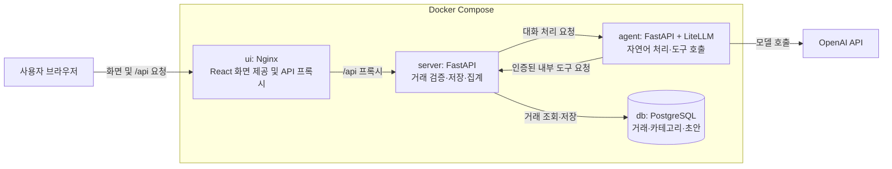

# AI 에이전트 가계부 설계 초안

이 문서는 구현 전에 서비스의 사용 형태, 서버와 AI 에이전트의 역할, Docker Compose 구성, 환경변수 관리 방식을 정리한다. 사용자가 말한 에이전트는 AI 에이전트로 해석한다. 핵심 형태는 **거래 목록과 통계 화면에 대화형 가계부 도우미를 결합한 서비스**다. 자연어로 거래를 입력하고 저장된 기록을 질문할 수 있으며, 실제 데이터 저장과 금액 계산은 서버가 책임진다.

## 설계의 전제

- UI 서버, API 서버, 에이전트, DB는 별도 서비스로 구성하고 Docker Compose로 함께 실행한다.
- 초기 샘플은 로컬 단일 사용자, 한국어, 원화, Asia/Seoul 시간대를 기준으로 한다. 로그인 기능은 초기 범위에 포함하지 않는다.
- 기술 스택은 아래 표를 기준으로 하고 AI 제공자는 OpenAI로 한다. 사용할 모델 ID는 구현 시 확정한다.
- 아래 경로, API, 환경변수 이름은 구현을 위한 제안이며 현재 존재하는 기능이 아니다.
- 참고 대상으로 지정된 [week06-agent-lab 저장소](https://github.com/2026-ai-service-engineering-a/week06-agent-lab)는 2026년 10월 5일에 접근하여 `main`의 커밋 `3311fd14e3fe6a20d2aa5b0cce975ea89b3c5e10` 기준으로 파일 목록, README, Compose, 의존성, 모델 설정 코드를 확인했다. 실제 `.env` 및 `.env.sample` 파일은 읽지 않았다.

## 참고 저장소와 가계부의 구성 비교

참고 저장소는 Python 여행 플래너 에이전트를 실행하는 실습 랩이다. [Compose 파일](https://github.com/2026-ai-service-engineering-a/week06-agent-lab/blob/3311fd14e3fe6a20d2aa5b0cce975ea89b3c5e10/docker-compose.yml)은 하나의 `lab` 서비스를 만들고, `.env`를 `env_file`로 전달하며, 소스를 `/app`에 마운트한다. 컨테이너는 `sleep infinity`로 대기하고 사용자가 명령으로 예제를 실행한다. 서버와 에이전트를 분리한 웹 서비스 구조는 아니다.

[의존성 파일](https://github.com/2026-ai-service-engineering-a/week06-agent-lab/blob/3311fd14e3fe6a20d2aa5b0cce975ea89b3c5e10/requirements.txt)에는 LiteLLM, Pydantic, pytest, MCP가 선언되어 있다. [모델 설정 코드](https://github.com/2026-ai-service-engineering-a/week06-agent-lab/blob/3311fd14e3fe6a20d2aa5b0cce975ea89b3c5e10/agent/config.py)는 `GEMINI_API_KEY`, `OPENAI_API_KEY`, `ANTHROPIC_API_KEY` 환경변수를 확인하여 사용 가능한 모델을 고른다. 이는 코드에서 확인한 이름이며 환경 파일의 내용을 읽은 결과가 아니다.

| 항목 | 참고 저장소에서 확인한 구성 | 가계부 설계안 |
| --- | --- | --- |
| 실행 방식 | 단일 `lab` 컨테이너에서 CLI 실행 | `ui`, `server`, `agent`, `db` 서비스 분리 |
| 환경 설정 | README에서 `.env.sample` 복사 안내, Compose의 `env_file: .env` | `.env.example` 제공, 서비스별 필요한 값만 전달 |
| 에이전트 모듈 | `config.py`, `tools.py`, `react.py`, `reflexion.py`, `harness.py`, `main.py` | 모델 설정, 가계부 도구, 호출 루프, 실행 제한을 분리하는 구조를 참고 |
| 테스트 | README에서 LLM mock을 사용하는 키와 네트워크 없는 테스트 안내 | 모델 mock 테스트와 거래 저장 및 중복 방지 통합 테스트 |

가계부에는 참고 저장소의 환경 설정과 에이전트 모듈 분리 방식을 적용한다. 단일 실습 컨테이너 구성은 사용자가 요청한 UI·서버·에이전트 분리 구조로 확장한다. LiteLLM Python SDK를 에이전트에 사용하고 OpenAI 모델을 호출한다. API 키 이름은 [OpenAI 공식 시작 안내](https://developers.openai.com/api/docs/quickstart)에 따라 `OPENAI_API_KEY`로 한다.

## 시스템 구성



브라우저에 공개하는 포트는 `ui` 하나다. 일반 거래 요청은 `ui → server → db`, 대화 요청은 `ui → server → agent`로 처리한다. 에이전트가 가계부 데이터를 조회하거나 등록 초안을 만들 때는 `server`의 인증된 내부 도구 API를 호출한다. 에이전트는 DB에 직접 연결하지 않는다. 실제 거래 확정은 사용자의 확인 요청을 받은 `server`가 수행한다.

## 서비스별 기술 스택

| 서비스 | 기술 스택 | 선택한 역할 |
| --- | --- | --- |
| `ui` | React, TypeScript, Vite로 화면 빌드; Nginx로 정적 파일 제공 및 `/api` 프록시 | 화면 개발과 배포용 웹 서버를 분리한다. 운영 컨테이너에는 Vite 개발 서버 대신 빌드 결과와 Nginx를 넣는다. |
| `server` | Python, FastAPI, Pydantic, SQLAlchemy, Alembic | HTTP API와 입력 검증, 거래·초안 처리, 집계 및 DB 스키마 마이그레이션을 담당한다. |
| `agent` | Python, FastAPI, LiteLLM Python SDK, Pydantic | 서버 간 HTTP 요청을 받고 자연어 추출·조회 도구 호출·응답 생성을 담당한다. ReAct 루프와 호출 한도는 이 서비스의 코드로 구현한다. |
| `db` | PostgreSQL | 거래·카테고리·초안 데이터를 영속 저장한다. Compose 명명된 볼륨을 사용한다. |

Nginx를 선택한 이유는 빌드된 React 정적 파일을 제공하면서 같은 주소의 `/api` 요청을 API 서버로 전달하기 위해서다. Vite는 개발과 빌드에 사용하고, 배포용 UI 컨테이너에서는 Nginx가 화면과 프록시를 맡는다. 초기 로컬 개발에서는 Vite 개발 서버를 사용할 수 있지만, Compose로 실행하는 샘플의 UI 서비스는 Nginx를 기준으로 한다.

서비스는 Docker Compose로 함께 실행한다. 구체적인 이미지 태그와 라이브러리 버전은 구현하면서 호환성을 검증한 뒤 고정한다. OpenAI 모델은 환경변수로 선택하며 `agent`에서만 API 키를 사용한다. 이 선택은 [Vite의 React·TypeScript 템플릿](https://vite.dev/guide/), [Nginx의 정적 파일 제공과 프록시 문서](https://docs.nginx.com/nginx/admin-guide/web-server/reverse-proxy/), [FastAPI의 컨테이너 배포 문서](https://fastapi.tiangolo.com/deployment/docker/), [SQLAlchemy ORM](https://docs.sqlalchemy.org/en/20/orm/quickstart.html), [Alembic](https://alembic.sqlalchemy.org/en/latest/), [LiteLLM Python SDK](https://docs.litellm.ai/docs/)를 기준으로 한 설계 결정이다.

## 사용자가 보는 가계부

| 화면 | 사용 방식 |
| --- | --- |
| 대시보드 | 선택한 월의 수입, 지출, 차액과 카테고리별 지출을 확인한다. 차액은 수입에서 지출을 뺀 값이며 실제 은행 잔액과 구분한다. |
| 거래 목록 | 날짜, 수입 또는 지출, 금액, 카테고리, 사용처, 메모를 조회하고 직접 등록하거나 수정한다. |
| AI 도우미 | 대화로 거래 등록 초안을 만들거나 기간별 소비 내역을 질문한다. |

예를 들어 사용자가 “오늘 점심에 12,000원 썼어”라고 입력하면 에이전트가 날짜, 지출 금액, 식비 카테고리를 추출해 저장 초안을 보여준다. 사용자가 확인하면 서버가 거래를 저장한다. “이번 달 식비 얼마야?”라는 질문에는 에이전트가 조회 도구를 호출하고, 서버가 계산한 합계를 바탕으로 답한다.

등록 결과와 답변에는 실제 저장 여부, 적용 기간과 필터를 보여준다. 조회할 기록이 없으면 기록이 없다고 안내한다. 불완전한 입력을 임의의 거래로 저장하지 않는다.

각 화면의 구성과 상태별 동작은 [UI 공통 설계](ui_docs/ui-design.md)에서 연결한 페이지별 문서에 정리한다.

## 초기 기능 범위

카테고리 추천과 통계의 교육용 확장 설계는 [가계부 AI 설계](ai/README.md)에 정리한다. RAG 카테고리 추천, 채팅 통계와 규칙 기반 통계는 후속 구현 제안이며 아래 초기 범위가 이미 구현되었다는 뜻은 아니다.

첫 구현은 수입과 지출의 직접 등록, 목록 조회, 수정과 삭제, 월별 합계, 카테고리별 합계, 자연어 등록 초안, 자연어 조회에 집중한다. 카테고리는 초기 기본 목록을 제공하고 분류가 애매하면 사용자가 선택한다.

영수증 이미지 인식, 은행 또는 카드 연동, 자동 이체, 투자 추천, 반복 거래 자동 등록, 여러 에이전트의 협업은 후속 범위로 둔다. 초기에는 하나의 에이전트가 제한된 도구를 사용하는 구성이 충분하다.

## UI 서버와 API 서버 및 에이전트의 역할

| 구성 요소 | 책임 |
| --- | --- |
| UI 서버 | React 화면을 Nginx로 제공하고 브라우저의 `/api` 요청을 API 서버로 프록시한다. |
| API 서버 | 입력 검증, 사용자 범위 제한, 거래 저장, 조회, 합계 계산, 등록 확인 처리를 담당한다. 서비스 이름은 `server`로 유지한다. |
| 에이전트 | 자연어 의도 파악, 거래 정보 추출, 조회 도구 선택, 결과 설명을 담당한다. |
| 데이터베이스 | 거래와 카테고리, 등록 초안 및 처리 상태를 영속적으로 저장한다. |
| OpenAI API | 에이전트가 요청한 자연어 해석과 응답 생성을 수행한다. |

화면은 `브라우저 → UI 서버`에서 제공한다. 대화 요청 경로는 `브라우저 → UI 서버의 /api 프록시 → API 서버 → 에이전트 → API 서버의 내부 도구 API → 데이터베이스`다. 에이전트는 필요한 경우 외부 LLM을 호출한다. 사용자의 확인 요청은 `브라우저 → UI 서버의 /api 프록시 → API 서버 → 데이터베이스`로 처리한다. API 서버는 에이전트의 결과도 다시 검증한다.

UI 서버는 `/api` 경로만 프록시하며 `/internal` 경로는 외부로 전달하지 않는다. 브라우저는 동일 출처의 상대 경로 `/api/...`를 사용한다. Compose 서비스 이름은 컨테이너 내부 주소이므로 브라우저에서 `http://server:8000`을 직접 호출하지 않는다. UI 서버는 DB나 에이전트에 직접 접근하지 않는다.

에이전트에 데이터베이스 접속 정보를 주거나 임의 SQL 실행 도구를 제공하지 않는다. 금액 합산, 기간 필터링, 사용자 권한은 서버의 정해진 로직으로 처리한다. 사용자 식별 정보는 서버가 전달하는 검증된 실행 문맥에서 가져오며 모델이 선택하지 않는다.

## 주요 처리 흐름

### 자연어 등록

1. 서버가 대화 입력과 기준 시각을 에이전트에 전달한다.
2. 에이전트가 거래 유형, 금액, 날짜, 카테고리, 메모를 구조화한다.
3. 금액이나 날짜 등 필수 정보가 부족하면 사용자에게 추가 입력을 요청한다.
4. 서버가 구조화된 결과를 검증하고 등록 초안을 저장한다.
5. 화면에서 초안을 확인하거나 수정한다.
6. 서버가 확정 요청을 받아 거래를 한 번만 저장하고 거래 ID를 반환한다.

“어제”와 “이번 달”은 서버가 제공한 Asia/Seoul 기준 시각으로 해석한다. 한 메시지에 여러 거래가 있으면 초안을 거래별로 나눠 확인한다. 수정과 삭제의 자연어 처리는 초기 범위에서 제외하고 거래 목록 화면에서 수행한다.

### 자연어 조회

1. 에이전트가 질문에서 기간, 거래 유형, 카테고리를 추출한다.
2. 서버의 조회 또는 집계 도구를 호출한다.
3. 서버가 요청 사용자에게 허용된 데이터만 조회한다.
4. 에이전트가 반환된 결과를 설명한다. 합계는 서버가 반환한 값 그대로 사용한다.

### 실패 처리

LLM 호출이 실패해도 직접 입력과 일반 통계 조회는 사용할 수 있어야 한다. 에이전트의 응답 형식이 잘못되면 저장하지 않고 재입력을 안내한다. 저장 실패는 저장 성공으로 표시하지 않는다. 확정 요청 재전송은 같은 초안 ID와 중복 방지 키로 처리하며 데이터베이스의 고유 제약으로 중복 거래를 막는다.

## 에이전트 도구와 API 제안

에이전트는 등록 초안 생성과 읽기 도구만 사용한다. 확정 저장 권한은 사용자 확인을 처리하는 서버 경로에 둔다.

| 도구 | 역할 |
| --- | --- |
| `list_categories` | 허용된 카테고리를 조회한다. |
| `prepare_transaction` | 거래 초안을 검증하고 생성한다. 실제 거래는 저장하지 않는다. |
| `list_transactions` | 기간과 카테고리 조건으로 거래를 조회한다. 페이지 크기를 제한한다. |
| `get_summary` | 서버가 계산한 기간별 수입, 지출, 차액과 카테고리별 합계를 반환한다. |

사용자용 API는 `GET /api/categories`, `POST /api/chat`, `GET/POST /api/transactions`, `PATCH/DELETE /api/transactions/{id}`, `GET /api/summary`, `POST /api/drafts/{id}/confirm`, `POST /api/transaction-draft`, `POST /api/category-recommendation`을 제안한다. 내부 도구 API는 `/internal/tools/...` 아래에 별도로 둔다. 초기 로컬 사용자용 경로에는 로그인을 넣지 않고 내부 경로에는 서비스 토큰을 적용한다. 경로별 상태 코드와 오류 응답은 [API 계약](api-contract.md)에 정리한다.

## 입력과 출력 예시

아래 JSON은 화면과 API 서버가 주고받을 **예상 형식**이다. 엔드포인트와 필드 이름은 구현할 때 확정한다. 브라우저는 UI 서버의 같은 주소에서 `/api/...`를 호출한다. 예시의 날짜와 금액은 설명을 위한 값이다.

### 화면에서 직접 거래 등록

사용자가 거래 입력 화면에서 날짜 `2026-10-05`, 지출 `12000원`, 카테고리 `식비`, 사용처 `점심`을 입력한다. UI는 다음 내용을 보낸다.

`POST /api/transactions`

```json
{
  "transaction_date": "2026-10-05",
  "type": "expense",
  "amount": 12000,
  "currency": "KRW",
  "category_id": "food",
  "merchant": "점심",
  "memo": ""
}
```

API 서버가 검증하고 저장한 뒤 다음처럼 응답한다. `amount`는 양의 정수이고 `type`으로 수입과 지출을 구분한다.

```json
{
  "id": "tx_001",
  "transaction_date": "2026-10-05",
  "type": "expense",
  "amount": 12000,
  "currency": "KRW",
  "category_id": "food",
  "merchant": "점심",
  "memo": "",
  "source": "manual"
}
```

대시보드는 선택한 월을 `GET /api/summary?month=2026-10`으로 조회한다. 서버가 저장된 거래를 합산해 다음처럼 반환한다. 이 값은 설명용이며 위의 거래 한 건만으로 계산한 결과는 아니다.

```json
{
  "month": "2026-10",
  "income_total": 2500000,
  "expense_total": 850000,
  "difference": 1650000,
  "currency": "KRW",
  "expenses_by_category": [
    { "category_id": "food", "amount": 85000 }
  ]
}
```

### 대화로 거래 초안 만들고 확인

사용자가 대화창에 “오늘 점심에 12,000원 썼어”라고 입력하면 UI가 다음 내용을 보낸다.

`POST /api/chat`

```json
{
  "message": "오늘 점심에 12,000원 썼어"
}
```

서버는 요청을 받은 시각과 사용자 문맥을 에이전트에 전달한다. 에이전트의 추출 결과를 서버가 검증한 뒤, **거래로 확정되지 않은 초안**을 반환한다.

```json
{
  "kind": "transaction_draft",
  "reply": "식비 12,000원 지출로 기록할까요?",
  "draft": {
    "id": "draft_001",
    "status": "pending",
    "transaction_date": "2026-10-05",
    "type": "expense",
    "amount": 12000,
    "currency": "KRW",
    "category_id": "food",
    "merchant": "점심",
    "memo": ""
  }
}
```

UI는 초안을 보여주고 사용자가 확인하거나 수정하게 한다. 확인하면 `POST /api/drafts/draft_001/confirm`을 호출한다. 수정 사항이 있으면 요청 본문의 `changes`에 넣고, 없으면 빈 객체를 보낸다. 중복 요청을 구분하는 `Idempotency-Key` 헤더도 함께 보낸다. 서버는 변경값을 다시 검증한 뒤 확정한다. 수정이 없는 요청 본문은 다음과 같다.

```json
{
  "changes": {}
}
```

사용자가 카테고리를 바꿨다면 `changes`에 `{ "category_id": "other" }`처럼 변경한 필드만 넣는다. 성공 응답은 다음과 같다.

```json
{
  "draft_id": "draft_001",
  "status": "confirmed",
  "transaction_id": "tx_002"
}
```

확인 전 초안은 거래 목록과 합계에 포함되지 않는다. 같은 초안을 다시 확정해도 새 거래를 만들지 않고 기존 `transaction_id`를 반환하도록 설계한다. 금액이나 날짜가 불명확하면 초안 대신 `kind: "clarification"`과 추가 질문을 반환한다.

### 대화로 합계 조회

사용자가 “이번 달 식비 얼마야?”라고 입력하면 같은 `POST /api/chat` 경로로 문장을 보낸다. 에이전트가 `get_summary` 도구를 선택하고 API 서버가 집계한 결과를 받아 다음처럼 응답한다. 이 예시에서 “이번 달”은 서버가 전달한 Asia/Seoul 기준 시각의 2026년 10월이다.

```json
{
  "kind": "answer",
  "reply": "2026년 10월 식비 지출은 85,000원입니다.",
  "summary": {
    "period_start": "2026-10-01",
    "period_end": "2026-10-31",
    "category_id": "food",
    "expense_total": 85000,
    "currency": "KRW"
  }
}
```

`reply`의 금액은 모델이 새로 계산하지 않고 서버가 반환한 `expense_total`을 사용한다. 데이터가 없으면 합계 `0`과 적용된 기간을 반환한다. 입력 검증이나 저장이 실패하면 UI가 성공으로 표시하지 않도록 오류 응답을 별도로 정의한다.

## 데이터 모델 제안

| 데이터 | 주요 항목 |
| --- | --- |
| 거래 | ID, 사용자 ID, 거래 날짜, 수입 또는 지출, 금액, 통화, 카테고리 ID, 사용처, 메모, 입력 방식, 생성 및 수정 시각 |
| 카테고리 | ID, 이름, 거래 유형 |
| 등록 초안 | ID, 사용자 ID, 거래 후보, 대기 또는 확정 또는 취소 상태, 만료 시각, 확정된 거래 ID |

원화 금액은 양의 정수로 저장하고 수입과 지출을 별도 유형으로 구분한다. 부동소수점으로 금액을 계산하지 않는다. 거래 날짜는 사용자가 지정한 현지 날짜로, 생성 및 수정 시각은 UTC로 저장한다. 초안에는 모델의 추측이 아닌 검증된 필드를 저장한다.

초기 샘플은 로컬 단일 사용자로 실행한다. 사용자 ID는 API 서버가 내부적으로 고정된 값으로 부여하고 브라우저나 모델 입력에서 받지 않는다. UI 포트는 `127.0.0.1`에만 공개한다. 외부 공개 또는 다중 사용자 단계에서는 로그인과 사용자별 접근 제어를 설계하고 구현한 뒤 공개한다. 대화 원문 저장은 초기 필수 기능으로 두지 않는다.

## Docker Compose 구성안

| 서비스 | 연결 | 설정과 저장 |
| --- | --- | --- |
| `ui` | 브라우저에 공개하는 유일한 서비스 | 화면 제공, `/api` 요청을 API 서버로 프록시 |
| `server` | Compose 내부에서 UI 서버 및 에이전트와 통신 | DB 연결, 에이전트 주소, 내부 인증 설정 |
| `agent` | Compose 내부에서 서버와 통신 | LLM 연결 설정과 서버 내부 도구 주소 |
| `db` | Compose 내부에서 서버와 통신 | PostgreSQL 및 명명된 볼륨 |

가계부 애플리케이션 서비스는 네 개로 계획한다. 현재 `compose.yaml`에는 문서 검증용 `scripts` 서비스만 있으며, 위 네 서비스는 아직 구현되지 않았다. 구현 후 컨테이너 내부에서는 `http://agent:8001`, `http://server:8000`, `db:5432`처럼 서비스 이름으로 연결한다. 이는 제안 포트이며 구현 시 확정한다. 초기 로컬 샘플에서는 UI 서버만 `127.0.0.1:3000`에 공개한다. API 서버, 에이전트, DB 포트는 호스트에 공개하지 않는다.

Nginx는 컨테이너 내부에서 모든 인터페이스에 바인딩해 호스트의 포트 전달을 받는다. React 화면은 Vite로 빌드해 Nginx가 제공한다. API 연결이 끊겼을 때 화면에는 오류와 재시도 안내를 표시한다.

DB healthcheck와 서버의 연결 재시도를 구성한다. 스키마 마이그레이션 완료 후 서버를 준비 상태로 만들고 에이전트도 준비 상태 확인 경로를 제공한다. 데이터는 DB 볼륨에 남으므로 일반 재시작 뒤 유지되어야 한다. 볼륨을 삭제하는 명령은 데이터 삭제 작업으로 별도 안내한다.

## 환경변수와 샘플 파일

구현 단계에서 실제 값이 없는 `.env.example`을 제공하고 실제 `.env`는 Git에서 제외한다. 이 설계 단계에서는 두 파일을 생성하거나 실제 `.env`를 읽지 않는다.

| 변수 제안 | 소비 서비스 | 의미 |
| --- | --- | --- |
| `UI_PORT` | Compose | 호스트에서 사용할 UI 서버 포트. 제안값 `3000` |
| `API_PROXY_TARGET` | UI 서버 | API 프록시 대상. 제안값 `http://server:8000`, 브라우저 번들에 전달하지 않음 |
| `APP_TIMEZONE` | 서버, 에이전트 | 기본값 `Asia/Seoul` |
| `POSTGRES_DB` | DB, 서버 연결 설정 | 데이터베이스 이름 |
| `POSTGRES_USER` | DB, 서버 연결 설정 | 데이터베이스 사용자 |
| `POSTGRES_PASSWORD` | DB, 서버 연결 설정 | 로컬에서 설정할 비밀번호 |
| `DATABASE_URL` | 서버 | DB 접속 문자열. DB 변수와 일관되게 구성 |
| `AGENT_BASE_URL` | 서버 | 에이전트 내부 주소 |
| `SERVER_INTERNAL_BASE_URL` | 에이전트 | 서버 도구 API 내부 주소 |
| `INTERNAL_SERVICE_TOKEN` | 서버, 에이전트 | 내부 서비스 요청 인증값 |
| `LLM_MODEL` | 에이전트 | 사용할 OpenAI 모델 ID. 구현 시 확정 |
| `OPENAI_API_KEY` | 에이전트 | OpenAI API 키. 실제 값은 샘플 파일이나 저장소에 넣지 않음 |
| `LLM_TIMEOUT_SECONDS` | 에이전트 | 모델 호출 시간 제한 |
| `AGENT_MAX_TOOL_CALLS` | 에이전트 | 요청당 도구 호출 상한 |

Compose의 `.env`는 변수 치환에 사용할 예정이며, 각 컨테이너에 필요한 값은 `environment` 등으로 명시적으로 전달한다. 전체 `.env`를 모든 서비스에 전달하지 않는다. API 키는 화면과 서버 응답에 노출하지 않고 로그에서 인증값을 제거한다. 모델에는 요청 수행에 필요한 거래 데이터만 전달한다.

## 구현 시 예상 폴더 구조

```text
account_book/
├── README.md
├── AGENTS.md
├── compose.yaml
├── Dockerfile.dev
├── requirements-dev.txt
├── pytest.ini
├── .env.example
├── .gitignore
├── .gitattributes
├── .dockerignore
├── .devcontainer/
│   └── devcontainer.json
├── scripts/
│   └── validate_docs.py
├── tests/
│   └── scripts/test_validate_docs.py
├── ui/
│   ├── Dockerfile
│   ├── nginx.conf
│   ├── src/
│   └── tests/
├── server/
│   ├── Dockerfile
│   ├── src/
│   ├── migrations/
│   └── tests/
├── agent/
│   ├── Dockerfile
│   ├── src/
│   └── tests/
└── docs/
    ├── agent-account-book-design.md
    ├── development-rules.md
    ├── python-conventions.md
    ├── api-contract.md
    └── ui_docs/
        ├── ui-design.md
        ├── dashboard.md
        ├── transactions.md
        ├── assistant.md
        └── mock-ui-development.md
```

현재는 문서, 검증 스크립트, Compose 검증 서비스, 브라우저 저장소로 동작하는 `ui/` 가계부, 거래 채우기와 RAG 카테고리 추천을 처리하는 로컬 API 서버가 작성되어 있다. 통계 채팅 도우미는 각본형 대역이며 별도 에이전트·DB 서비스는 구현 예정 구조다.

## 구현 순서와 완료 기준

1. UI 서버, API 서버, DB, Compose와 샘플 환경변수를 구성하고 화면에서 직접 입력 및 거래 조회를 만든다.
2. 서버에서 월별 집계와 카테고리별 합계를 계산하고 화면에 연결한다.
3. 에이전트 서비스를 연결해 자연어 등록 초안과 사용자 확인을 구현한다.
4. 읽기 도구를 연결해 자연어 통계 질문에 답하도록 한다.
5. 정상 동작, 실패 처리, 데이터 영속성을 검증하고 README에 실행 방법을 추가한다.

샘플 완료 여부는 다음 시나리오로 확인한다.

- UI 서버 주소에서 화면이 열리고 `/api` 프록시를 통해 거래 조회와 등록이 동작한다.
- 호스트에는 UI 포트만 공개되고 UI 서버를 통한 `/internal` 경로 접근은 차단된다.
- 직접 등록한 거래가 조회되고 재시작 후에도 유지된다.
- 자연어 입력으로 생성된 초안은 확인 전에는 거래 합계에 포함되지 않는다.
- 동일한 초안 확정 요청을 두 번 보내도 거래가 하나만 생긴다.
- 월 경계와 상대 날짜가 Asia/Seoul 기준으로 처리된다.
- 조회 답변의 합계가 서버 집계 결과와 일치한다.
- 금액 누락, 잘못된 카테고리, 만료된 초안은 저장되지 않는다.
- LLM 장애 중에도 직접 입력과 서버 통계 조회가 동작한다.
- 내부 도구 호출은 인증과 사용자 범위를 검증한다.
- 샘플 파일과 저장소에 실제 비밀값이 포함되지 않는다.

## 구현 전에 확정할 항목

사용할 OpenAI 모델 ID와 구체적인 패키지 버전을 확정해야 한다. 참고 저장소의 단일 실습 컨테이너와 에이전트 모듈을 바탕으로 가계부의 UI·서버·에이전트 분리 구조에 맞게 적용한다. 현재 문서는 이 가계부의 기능과 책임 경계를 정의하며, 참고 저장소의 구현을 그대로 복제하는 것은 아니다.
