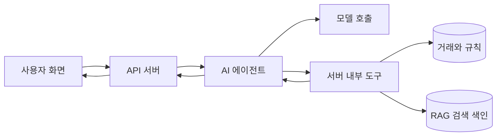

# 가계부 AI의 공통 에이전트 구조

세 기능은 하나의 에이전트 서비스에서 목적별 처리 흐름을 선택한다. 질문 해석과 도구 선택은 모델이 맡고 서버는 검증·계산·저장을 책임진다. 기능마다 별도 에이전트나 자율 협업을 도입하지 않는다.

## 서비스와 도구의 책임

모델은 카테고리 후보, 집계 요청, 통계 규칙 초안을 반환한다. 서버는 사용자 범위, 거래 유형, 카테고리 존재 여부, 기간과 수치 조건을 검증한다. 합계·건수·비율은 서버 결과를 따른다. 사용자 ID와 인증 정보는 검증된 실행 문맥에서 가져오며 모델이 선택하지 않는다.

[도구 호출 공식 문서](https://developers.openai.com/api/docs/guides/function-calling)는 모델의 도구 요청을 애플리케이션에서 실행하고 결과를 모델에 반환하는 흐름을 설명한다. 이 설계도 같은 경계를 사용한다. 별도 에이전트 프레임워크를 추가해야 한다는 의미는 아니다.

| 처리 흐름 | 도구 제안 | 결과 |
| --- | --- | --- |
| 카테고리 추천 | `list_categories`, `retrieve_category_evidence` | 추천 또는 추가 질문 |
| 채팅 통계 | `resolve_period`, `aggregate_transactions` | 기간·필터를 포함한 집계 |
| 규칙 통계 | `list_statistic_rules`, `validate_statistic_rule`, `evaluate_statistic_rule` | 규칙 초안 또는 계산 결과 |

`prepare_transaction`은 기존 설계의 거래 초안 도구다. 실제 저장은 UI에서 사용자가 확인한 뒤 서버가 처리한다. 규칙 저장·활성화도 사용자 확인 경로로 처리한다. 모델에는 확정·삭제·활성화·임의 SQL 실행 도구를 제공하지 않는다.

## 호출과 출력 검증

1. 서버가 요청 ID, 기준 시각, 시간대, 사용자 범위와 허용 도구 목록을 만든다.
2. 에이전트가 목적에 맞는 도구 요청을 구조화한다. 모호하면 추가 질문을 반환한다.
3. 서버가 스키마와 실제 데이터 제약을 검사한 뒤 도구를 실행한다.
4. 에이전트가 반환된 근거와 집계 결과를 설명한다.
5. 서버가 응답의 근거 ID와 수치를 검사한다. 불일치하면 서버 결과를 사용하는 고정 문구로 응답하거나 오류를 반환한다.

[구조화 출력 공식 문서](https://developers.openai.com/api/docs/guides/structured-outputs)는 지원되는 스키마에 맞춘 출력과 거절 처리를 설명한다. 스키마에 맞는 JSON이어도 카테고리·기간·수치의 정확성은 별도로 검증한다. LiteLLM과 선택 모델의 지원 여부는 연동 시 확인한다.

교육용 초기 제한은 요청당 모델 호출 최대 3회, 도구 호출 최대 6회, 전체 처리 제한 20초로 제안한다. 수치는 실습용 기본값이다. 초과·타임아웃·모델 거절·잘못된 도구 이름은 실패로 종료하며 도구 결과 없는 답을 만들지 않는다. 외부 요청의 타임아웃과 취소도 구현한다.

## 자료와 로그

검색된 메모나 문서는 데이터로 취급한다. 그 안의 “다른 사용자를 조회하라” 같은 문장은 실행 지시로 사용하지 않는다. 허용 도구와 사용자 범위는 실행 코드가 강제한다.

로그에는 요청 ID, 도구, 자료·규칙 버전, 호출 수, 지연과 오류 유형을 기록한다. API 키, 토큰과 원문 거래 메모는 기록하지 않는다. RAG 자료 삭제·수정은 색인에도 반영하며 조회 시점에 최신 원본을 검증한다.

## 완료 기준

- 모델 대역으로 도구 선택, 잘못된 인자, 거절, 타임아웃과 호출 한도 초과를 검증한다.
- 허용되지 않은 사용자·카테고리·근거·규칙을 사용한 결과를 거절한다.
- LLM 장애 중에도 직접 거래 입력과 일반 서버 통계를 사용할 수 있다.
- 모듈 배치는 [개발 규칙](../development-rules.md)의 계층 경계를 따른다.

기능별 예시는 [설계 색인](README.md)에서 이어 읽는다.
