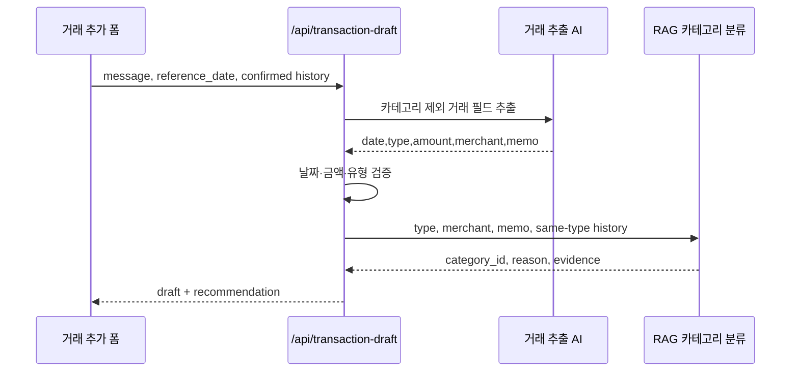

# AI 거래 채우기 구현

카드 승인 문자나 자연어 거래 문장을 붙여넣고 **채우기**를 누르면 거래 추출 AI와 RAG 카테고리 분류가 순서대로 호출된다. 결과는 기존 거래 폼에 수정 가능한 초안으로만 반영되며, 사용자가 **거래 저장**을 누르기 전에는 브라우저 저장소에 기록되지 않는다.

## 추가 요구사항 원문

```text
여기에 할 것은 카드 메시지를 붙여넣기를 하면, 내용이 자동적으로 골라지고, 이걸 ai를 통해서 하는 방식으로 가보자. 다만, 아직 ai를 적용할 것은 아니고, ui를 통해서 적용하는 모습만 보여주는 목으로 만들 거야.
```

```text
그럼 채우기를 누르면 거래 추출 AI랑 RAG 카테고리 분류가 순서대로 호출되도록 해줘. 설계 문서랑 mermaid도 같이 반영해줘
```

## 구현 계획과 사용 흐름

1. 거래 추가 폼의 채팅 입력에서 카드 문자나 거래 문장을 받는다.
2. `/api/transaction-draft`가 거래 추출 AI를 호출해 날짜·유형·금액·사용처·메모를 만든다.
3. 서버가 추출값을 검증한다. 금액·유형·날짜가 부족하거나 여러 거래로 보이면 추가 질문을 반환하고 RAG를 호출하지 않는다.
4. 검증된 사용처·메모·유형으로 기존 `/api/category-recommendation`의 RAG 분류를 이어서 실행한다.
5. 카테고리 추천이 성공하면 초안의 카테고리를 채우고, 모호하거나 장애가 있으면 빈 카테고리로 남겨 직접 선택하게 한다.
6. 입력 변경·수동 수정·폼 닫기 중 도착한 응답은 무효화한다.



거래 추가 폼에서 **채팅으로 거래 채우기**를 펼치고 문장을 입력한 뒤 **채우기**를 누른다. 문자를 넣으면 필드가 자동으로 채워지고 추천 이유가 표시된다. **문장 예시**와 **카드 문자 예시**로 합성 입력을 넣을 수도 있다. 카테고리는 추천 뒤에도 드롭다운에서 직접 선택한다.

## 예시와 검증

```text
[Web발신]
모아카드 승인
5,500원 일시불
2026/10/13 14:30
달빛커피
누적 125,500원
```

추출 결과는 날짜 `2026-10-13`, 지출 `5,500원`, 사용처 `달빛커피`다. 이후 RAG가 카테고리 정의와 확정 거래 근거를 검색해 `카페`를 추천한다. 누적 이용 금액은 이번 거래 금액으로 사용하지 않는다. 날짜가 없으면 Asia/Seoul 기준 날짜를 사용하고, 시간 표현은 별도 필드가 없어 메모에 보존한다.

해외 통화, 취소·거절, 여러 거래, 금액이나 수입·지출 유형을 확정할 수 없는 문자는 안내하고 저장을 막는다. **직접 입력으로 계속**을 누르면 문자 입력을 비우고 폼에서 직접 입력할 수 있다. 알 수 없는 카테고리는 필수 선택 검증으로 저장을 막는다.

## 현재 범위

카드사별 모든 형식, 해외 결제, 취소 거래, 이미지·영수증 인식과 중복 문자 판별은 지원하지 않는다. 현재 구현은 거래 한 건의 입력 흐름에 집중한다. 문장 원문과 확정 거래의 최소 분류 내역은 AI 서버로 전송된다. API 키는 서버 환경변수에서만 읽고 브라우저에는 노출하지 않는다.

통계 채팅 화면은 여전히 `scriptedAssistant` 기반 각본형 대역이다. 이 문서의 실제 AI 호출은 거래 추가 폼의 채우기 흐름에만 해당한다.
