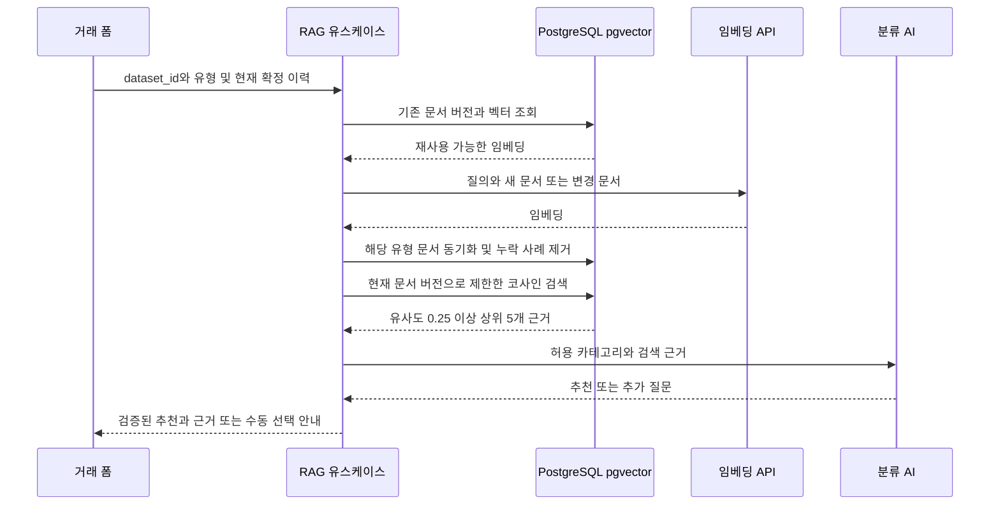

# RAG 카테고리 추천 구현

## 요구사항과 범위

[이슈 #5: 카테고리 고르기 by AI](https://github.com/hyeon81/account_book/issues/5)의 사용자 설명:

> 사용자가 어떤 지출 내역을 혹은 수입 내역을 입력하면,
> RAG 내역들을 바탕으로 카테고리를 분류하는 그런 기능.
> 일반적으로는 사용자가 입력하고, AI 버튼이 잇어서 AI 버튼을 누르면 AI가 결정해준다

거래 폼의 AI 버튼은 카테고리만 추천한다. **채우기** 버튼은 거래 추출 AI를 먼저 호출하고, 추출 성공 후 같은 요청 안에서 RAG 카테고리 분류를 호출한다. 추천과 거래 초안은 수정 가능한 폼에만 적용하며 사용자가 확인해 저장한다.

현재 구현은 로컬 단일 사용자용이다. 거래 원본은 브라우저 `localStorage`에 유지한다. 서버의 PostgreSQL·pgvector에는 카테고리 정의와 확정 거래의 최소 검색 자료 및 임베딩을 저장한다. 이전 메모리 검색과 달리 변경되지 않은 자료의 임베딩은 요청과 컨테이너 재시작 사이에 재사용한다. 로그인, 다중 사용자 권한, 전체 거래 동기화, 별도 에이전트 서비스는 포함하지 않는다.

## 실행과 설정

Docker Desktop을 켠 뒤 저장소 루트에서 실행한다.

```bash
docker compose up --build
```

UI는 `http://localhost:8080`에서 열린다. 개발 UI는 다음 명령과 `http://localhost:5173`을 사용한다.

```bash
docker compose -f docker-compose.dev.yml up --build
```

두 구성 모두 PostgreSQL 상태 확인 후 DB 초기화와 API 시작을 진행한다. API와 DB 포트는 호스트에 공개하지 않는다. DB 자료는 Compose 영속 볼륨에 남으며 일반적인 `docker compose down`으로 삭제되지 않는다. 볼륨을 삭제하면 저장된 검색 자료와 임베딩도 삭제된다. 거래 원본인 브라우저 저장소에는 영향을 주지 않는다.

`.env.example`에는 `DATABASE_URL`, `POSTGRES_USER`, `POSTGRES_PASSWORD`, `POSTGRES_DB`와 서버용 OpenAI 설정의 예시가 있다. Compose의 기본 `DATABASE_URL`은 내부 DB 호스트 `db`를 사용한다. DB 연결 주소와 PostgreSQL 계정 설정을 일치시킨다. 호스트에서 API를 직접 실행하면 도달 가능한 PostgreSQL 주소를 별도 지정해야 한다. 실제 비밀값은 로컬 실행 환경에서 설정하며 실제 `.env`를 읽거나 커밋하지 않는다. Compose는 실행 시 설정 파일을 로드할 수 있지만 이미지에는 포함하지 않는다. 키와 DB 연결 정보는 브라우저로 전달하지 않는다.

임베딩 모델 기본값은 `OPENAI_EMBEDDING_MODEL=text-embedding-3-small`, 차원은 `OPENAI_EMBEDDING_DIMENSIONS=1536`, 분류 모델 기본값은 `OPENAI_CATEGORY_MODEL=gpt-4.1-mini`다. 임베딩 모델을 바꾸면 해당 모델이 지원하는 차원을 함께 설정한다. 거래 추출 모델은 `OPENAI_TRANSACTION_MODEL`로 별도 지정할 수 있고 없으면 분류 모델을 사용한다. 생성 모델은 Responses API의 Structured Outputs를 지원해야 한다.

서버의 추가 런타임 의존성은 승인된 `psycopg[binary]`다. pgvector는 PostgreSQL 확장을 사용하며 Python 벡터 라이브러리는 추가하지 않는다. SQL 마이그레이션은 버전 관리하며 다음 명령으로 실행한다.

```bash
python -m account_book_server.migrate
```

반복 실행해도 기존 자료를 유지한다. 직접 실행할 때는 서버 패키지를 설치하고 `DATABASE_URL`을 서버 환경에 주입한다. Compose의 API 시작 과정도 같은 마이그레이션 명령을 사용한다.

## 자료 구분과 임베딩 재사용

브라우저는 UUID를 만들어 `localStorage`에 유지하고 두 AI 요청에 필수 `dataset_id`로 전달한다. 브라우저·출처별로 자료를 구분하기 위한 값이며 인증 토큰이나 사용자 권한이 아니다. 이 API를 다중 사용자 인터넷 서비스로 공개하는 것은 현재 범위 밖이다.

| 저장 항목 | 내용 |
| --- | --- |
| 문서 ID·출처 | `category:<id>` 또는 `transaction:<id>` |
| 자료 구분·유형 | `dataset_id`, `income` 또는 `expense` |
| 카테고리 | 현재 확정된 허용 카테고리 ID |
| 최소 텍스트 | 카테고리 이름·설명 또는 거래의 사용처·메모 |
| 재사용 기준 | 텍스트 해시, 임베딩 모델·차원, 문서 형식 버전 |
| 벡터 | 해당 모델로 생성한 임베딩 |

금액·날짜·거래 추출 원문은 검색 저장소에 저장하지 않는다. 메모 자체에 입력된 내용은 최소 텍스트에 포함될 수 있다. 카테고리 정의는 서버 목록이 기준이다.

1. 현재 요청의 같은 유형 카테고리 정의와 확정 이력으로 검색 문서를 만든다. 기존 최근 100건·요청 크기 제한을 유지하고 수정 중인 자기 거래는 UI에서 제외한다.
2. 같은 자료 구분·거래 유형에서 요청에 빠진 사례를 제거한다. 빈 이력이면 해당 유형의 거래 사례를 모두 제거하고 카테고리 정의는 유지한다. 다른 유형의 이력은 지우지 않는다.
3. 텍스트 해시·모델·차원·문서 형식이 일치하면 기존 임베딩을 재사용한다. 같은 사용처·메모에서 카테고리만 바뀌면 메타데이터만 갱신한다. 새 문서와 내용이 바뀐 문서만 임베딩한다.
4. 질의는 요청마다 임베딩한다. 질의와 자료의 모델·차원이 다른 벡터는 비교하지 않는다.
5. 현재 요청의 문서 ID·내용 버전과 일치하는 자료만 검색해 동시 요청에서 오래된 근거가 섞이지 않게 한다. 카테고리도 현재 요청과 대조한다.
6. pgvector의 코사인 거리로 정확 검색을 수행하고 유사도 0.25 이상 상위 5개만 생성 모델에 전달한다. 현재 규모에서는 근사 검색 인덱스를 만들지 않는다. 유사도는 정답 확률이 아니다.

수정·삭제는 저장 버튼을 누른 즉시 서버로 보내지 않는다. **다음 AI 요청**의 확정 이력 스냅샷으로 해당 유형의 검색 자료에 반영한다. 브라우저 데이터 삭제만으로 DB의 이전 자료를 즉시 삭제하지는 않는다. 변경된 자료를 임베딩할 수 없으면 해당 추천은 실패하며 이전 내용을 대신 사용하지 않는다.



## 추천 API

`POST /api/category-recommendation`은 JSON을 받는다. `dataset_id`는 필수 UUID다. `history`는 현재 브라우저에서 확정한 같은 유형의 최근 이력 스냅샷이며, 추천 자체는 확정 사례가 아니다. 금액과 날짜는 전송하지 않는다.

```json
{
  "dataset_id": "36d8d4d7-68c1-4eca-8fda-bb766bf74a38",
  "type": "expense",
  "merchant": "달빛커피",
  "memo": "라떼",
  "history": [
    {"id": "saved-1", "type": "expense", "category_id": "cafe", "merchant": "달빛커피", "memo": "아메리카노"}
  ]
}
```

```json
{
  "status": "recommended",
  "category_id": "cafe",
  "reason": "저장된 커피 거래를 참고했어요.",
  "evidence_ids": ["transaction:saved-1"],
  "requires_confirmation": true,
  "evidence": [
    {"id": "transaction:saved-1", "category_id": "cafe", "source": "transaction", "text": "거래처: 달빛커피\n메모: 아메리카노"}
  ]
}
```

응답 형식은 기존과 같다. `recommended`는 검증된 추천, `needs_clarification`은 근거 부족·모호함, `unavailable`은 DB·공급자 장애 또는 잘못된 출력이다. 뒤의 두 상태는 `category_id: null`이며 수동 선택을 덮어쓰지 않는다. 정의만 근거가 될 수도 있지만 근거가 전혀 없으면 임의 기본 카테고리를 추천하지 않는다.

## 거래 채우기 API

`POST /api/transaction-draft`도 `dataset_id`를 필수로 받는다. 추출 모델은 카테고리를 만들지 않는다. 서버가 추출 결과를 검증한 뒤 RAG가 같은 유형의 카테고리 정의와 확정 거래만 동기화·검색한다.

```json
{
  "dataset_id": "36d8d4d7-68c1-4eca-8fda-bb766bf74a38",
  "message": "오늘 오후 3시에 카페에서 5천원 썼어",
  "reference_date": "2026-10-20",
  "timezone": "Asia/Seoul",
  "history": [
    {"id": "saved-1", "type": "expense", "category_id": "cafe", "merchant": "달빛커피", "memo": "아메리카노"}
  ]
}
```

```json
{
  "status": "draft",
  "reason": "카페 정의를 참고했어요.",
  "requires_confirmation": true,
  "draft": {
    "date": "2026-10-20",
    "type": "expense",
    "amount": 5000,
    "categoryId": "cafe",
    "merchant": "카페",
    "memo": "오후 3시"
  },
  "recommendation": {
    "status": "recommended",
    "category_id": "cafe",
    "reason": "카페 정의를 참고했어요.",
    "evidence_ids": ["category:cafe"],
    "requires_confirmation": true,
    "evidence": [
      {"id": "category:cafe", "category_id": "cafe", "source": "category", "text": "카페: 커피와 음료"}
    ]
  }
}
```

추출이 모호하면 `needs_clarification`과 추가 질문을 반환하고 RAG를 호출하지 않는다. 추출 실패는 `unavailable`로 끝난다. RAG만 실패하면 추출된 초안은 유지하되 `categoryId`를 비워 사용자가 직접 선택하게 한다. UI는 응답 도착 시점에 현재 확정 거래 근거를 다시 검증하고 입력이 바뀌거나 폼이 닫힌 경우 응답을 폐기한다.

문장은 4,000자, 사용처는 500자, 메모는 1,000자, 거래 ID는 100자, 사례는 100건, 본문은 200KB로 제한한다. 잘못된 UUID를 포함한 입력 오류는 400, 요청 크기는 413, JSON 이외는 415, 허용되지 않은 Origin은 403, 동시 처리 초과는 503으로 응답한다. 기본 허용 Origin은 localhost와 127.0.0.1의 8080·5173이다. 다른 로컬 미리보기 주소는 서버의 `CATEGORY_ALLOWED_ORIGINS`에 쉼표로 나눠 지정한다.

## 자료 처리와 검증

AI를 요청하면 질의와 새롭거나 변경된 검색 자료를 OpenAI 임베딩 API로 전송한다. 채우기는 원문 문장도 추출 모델로 전송한다. 검색된 근거만 Responses API로 전달하며 `store: false`를 지정한다. 공급자의 데이터 처리 정책 전체가 이 값 하나로 결정되는 것은 아니다. 서버는 본문·비밀값·공급자 오류 내용을 로그에 남기지 않고 응답 캐시도 금지한다.

저장·검색은 애플리케이션 인터페이스로 분리해 단위 테스트에 대역을 주입한다. 실제 PostgreSQL 통합 테스트는 마이그레이션 반복 실행, 문서 저장·갱신·삭제, 임베딩 재사용, 정확 코사인 검색, 모델·차원·자료 구분·유형 분리와 동시 요청의 근거 버전을 검증한다. 컨테이너 재시작 후에도 기존 벡터를 재사용하는지 별도로 확인한다.

```bash
pytest
python scripts/validate_docs.py
npm --prefix ui test
npm --prefix ui run lint
npm --prefix ui run build
```

실제 DB 통합 검증은 DB를 먼저 시작하고 같은 Compose 프로젝트의 검증 컨테이너에서 실행한다. 아래 연결 정보는 기본 로컬 설정의 예시다. 계정을 변경했다면 연결 주소도 맞추되 비밀값을 저장소에 기록하지 않는다.

```bash
docker compose up -d db
docker compose run --rm -e TEST_DATABASE_URL=postgresql://account_book:account_book_local@db:5432/account_book scripts pytest server/tests/test_postgres_vector_store.py
```

`TEST_DATABASE_URL`이 없는 일반 테스트 실행에서는 실제 DB 통합 테스트가 건너뛰어질 수 있으므로 단위 테스트 통과만으로 DB 검증을 대체하지 않는다. 통합 테스트에는 실제 키를 사용하지 않는다.

자동 테스트에는 실제 키를 사용하지 않는다. 실제 AI를 사용하는 거래 채우기와 카테고리 단독 추천은 별도로 확인한다. [pgvector 공식 문서](https://github.com/pgvector/pgvector), [임베딩 공식 문서](https://developers.openai.com/api/docs/guides/embeddings), [구조화 출력 공식 문서](https://developers.openai.com/api/docs/guides/structured-outputs?api-mode=responses)를 참고한다.
