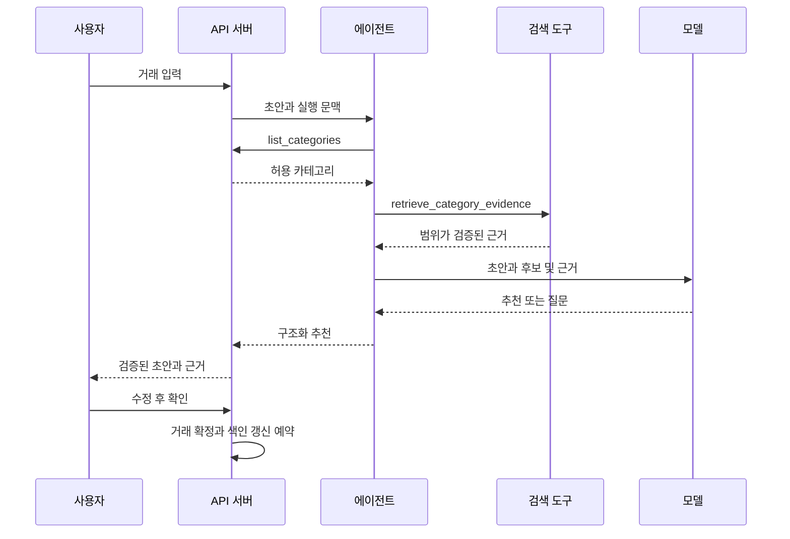

# RAG를 활용한 가계부 카테고리 추천

사용처와 메모가 포함된 거래 초안에 카테고리를 추천하고 근거를 보여준다. RAG는 관련 자료를 검색한 뒤 그 자료를 모델 입력에 넣어 답을 생성하는 방식이다. 이 실습에서는 카테고리 정의와 사용자가 확정한 분류 사례를 검색한다.

## 학습 목표와 사용 예

“어제 달빛커피에서 라떼 5,500원”을 입력하면 거래 정보를 추출하고 카페 정의와 유사한 확정 사례를 검색한다. 모델은 검색 근거로 `cafe`를 추천한다. 사용자는 카테고리를 바꿀 수 있고 확인 전에는 거래나 검색 사례로 저장되지 않는다.

사용자 수정은 검색 자료 갱신으로 반영하며 모델을 매번 재학습하지 않는다. [공식 검색 문서](https://developers.openai.com/api/docs/guides/retrieval)는 임베딩 기반 의미 검색과 속성 필터링을 설명한다. 이 설계는 제품을 확정하지 않고 해당 개념을 서버의 검색 인터페이스에 적용한다.

## 검색 자료와 색인

| 자료 | 검색 내용 | 조건 |
| --- | --- | --- |
| 카테고리 정의 | 이름, 설명, 포함·제외 예, 수입·지출 유형 | 현재 허용된 ID |
| 확정 거래 사례 | 사용처, 최소한의 메모, 확정 카테고리 | 같은 사용자의 확정 거래 |
| 사용자 분류 선호 | 사용처별 분류 기준과 수정 사례 | 사용자 확인과 자료 버전 |

정의 하나 또는 사례 하나를 검색 단위로 만들고 `evidence_id`, `category_id`, `type`, `scope`, `owner_id`, `source_id`, `source_version`을 메타데이터로 둔다. 전역 정의는 서버가 관리하고 개인 사례는 해당 사용자에게만 공개한다. 전체 가계부를 프롬프트에 넣지 않는다.

자료 정규화 → 문서 생성 → 임베딩 생성 → 벡터·메타데이터 저장 순서로 색인을 준비한다. 거래 수정·삭제와 카테고리 변경은 같은 원본 ID의 자료를 갱신·제거한다. 임베딩 모델 변경 시 색인 버전을 분리하고 질의와 자료는 같은 모델로 임베딩한다.

첫 실습은 합성 자료와 검색 결과 대역으로 시작한다. 실제 RAG 실습에서는 임베딩 검색과 모델 생성을 모두 연결한다. 키워드 검색 단계와 벡터 검색 단계를 실습 결과에 구분한다.

## 에이전트 처리 흐름



1. 초안의 사용처·메모·유형을 검색어로 만든다. 금액·날짜가 부족하면 등록 흐름에서 추가 질문한다.
2. `list_categories`로 현재 유형별 허용 카테고리를 가져온다.
3. 서버는 검색 전에 사용자 범위와 거래 유형을 제한하고 반환 전에 최신 원본을 대조한다.
4. 상위 5개 근거를 실습 기본값으로 반환한다. 적합한 근거가 없으면 빈 결과를 허용한다. 유사도는 정답 확률이 아니다.
5. 모델은 후보 ID와 근거를 받아 추천하거나 모호한 부분을 질문한다. 설명에는 반환된 근거 ID만 넣는다.
6. 서버는 후보 존재·유형, 근거 소유 범위·버전, 추천과 근거의 관계를 검증한다.

## 추천 결과 예시

아래는 내부 추천 결과 제안이다. 성공하면 기존 `transaction_draft`에 반영하고 추가 정보가 필요하면 `clarification`으로 변환한다.

```json
{
  "status": "recommended",
  "category_id": "cafe",
  "reason": "카페 정의에 음료 구매가 포함되며, 확정된 같은 사용처 사례도 카페입니다.",
  "evidence_ids": ["category_cafe_v1", "confirmed_example_17_v2"],
  "requires_confirmation": true
}
```

`status`는 `recommended`, `needs_clarification`, `unavailable` 중 하나다. 뒤의 두 상태는 `category_id: null`로 반환해 모호함과 장애를 구분한다. 정의만 근거가 될 수도 있지만 근거가 전혀 없으면 임의 기본 카테고리를 추천하지 않는다. 모델의 자신감 수치로 자동 확정하지 않는다.

## 수정과 실패 처리

사용자가 추천을 바꾸면 최종 확정 카테고리만 사례로 색인한다. 확인하지 않은 추천을 검색 자료로 넣지 않아 오분류가 반복 강화되지 않도록 한다. 삭제된 카테고리·사례는 제외하고 유효 근거가 없으면 직접 선택을 안내한다.

식사와 음료가 함께 등장하거나 선호가 충돌하면 사용자에게 묻는다. 검색·모델 장애에도 직접 카테고리 선택을 유지한다. 메모 속 지시는 [공통 에이전트 구조](agent-architecture.md)의 도구 권한을 바꾸지 않는다.

## 교육 실습과 평가

1. 현재 UI ID인 `cafe`, `food`, `transport`, `shopping`, `health`, `living`, `salary`, `other-income`의 정의와 합성 확정 사례를 준비한다. 서버 목록이 최종 기준이다.
2. 키워드 분류, 검색 없는 모델, RAG를 동일한 정답 자료로 비교한다. 애매한 예의 정답은 추가 질문으로 둔다.
3. 색인용과 평가용 자료를 분리하고 평가 거래 자체를 색인하지 않는다. 사용자별 자료와 수정 시점도 분리한다.
4. 처음 보는 사용처, 상충 사례, 빈 검색, 삭제된 카테고리, 유형 혼동, 악성 메모와 다른 사용자 자료를 시험한다.

검색은 `Recall@5`로 필요한 근거가 상위 5개에 포함된 비율을 측정한다. 명확한 사례의 추천 정확도, 모호한 사례의 추가 질문 비율, 설명 근거의 유효성을 함께 기록한다. 지연·호출 비용도 기록하되 실제 측정 없이 성능 결과로 적지 않는다.

근거 없는 추천과 사용자 범위 누출을 차단하고 수정·삭제가 다음 검색에 반영되며 장애 후 직접 입력을 유지하면 완료다. 평가 목표 수치는 실습 자료 확정 후 정한다.
