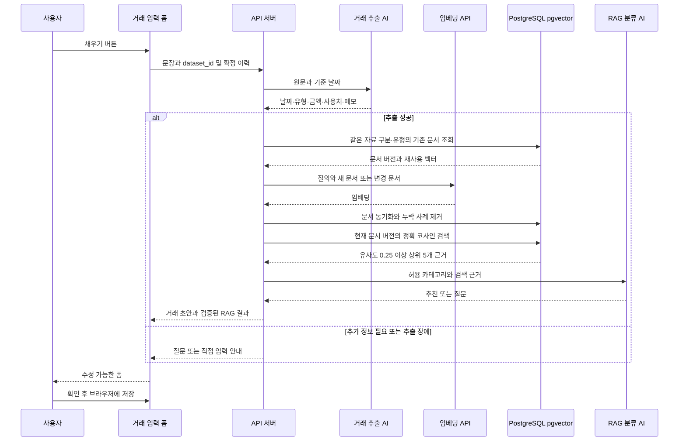

# RAG를 활용한 가계부 카테고리 추천

사용처와 메모가 포함된 거래 초안에 카테고리를 추천하고 근거를 보여준다. 카테고리 정의와 사용자가 확정한 분류 사례를 임베딩해 검색한 뒤 검색 근거를 분류 모델에 전달한다. 현재 실행 구성과 JSON 예시는 [RAG 카테고리 추천 구현](category-rag-implementation.md)에 있다.

## 현재 구현과 학습 목표

“오늘 달빛커피에서 라떼 5,500원”을 입력하고 채우기를 누르면 거래 정보를 추출한 뒤 RAG를 호출한다. 카테고리만 직접 입력하기 어려우면 카테고리 영역의 AI 버튼을 사용할 수 있다. 사용자는 결과를 바꿀 수 있고 확인 전에는 거래나 확정 사례로 저장되지 않는다.

거래 원본은 브라우저에 있다. 서버의 PostgreSQL·pgvector에는 카테고리 정의, 확정 거래의 사용처·메모·카테고리와 임베딩을 영속 저장한다. 모델을 재학습하는 대신 자료 변경을 반영해 검색한다. 기존 메모리 검색에서 요청마다 전체 자료를 임베딩하던 동작을 변경 자료 임베딩과 DB 검색으로 교체했다.

## 검색 자료와 동기화

| 자료 | 검색 내용 | 조건 |
| --- | --- | --- |
| 카테고리 정의 | 이름, 설명 | 서버의 현재 허용 ID·거래 유형 |
| 확정 거래 사례 | 사용처, 메모 | 현재 브라우저가 전달한 같은 유형의 확정 이력 |

정의 하나 또는 사례 하나가 검색 문서다. 문서 ID, `dataset_id`, 거래 유형, 카테고리 ID, 최소 텍스트, 텍스트 해시, 임베딩 모델·차원, 문서 형식 버전과 벡터를 저장한다. 금액·날짜·거래 추출 원문은 검색 저장소에 저장하지 않는다.

브라우저의 `dataset_id` UUID는 출처별 `localStorage`에 유지하며 두 AI 요청에 필수로 넣는다. 이는 자료를 구분하는 값이며 로그인이나 접근 권한을 보장하지 않는다. 로그인·다중 사용자 권한·전체 거래 동기화는 후속 범위다.

현재 요청을 검색 자료의 기준으로 삼는다. 같은 자료 구분·거래 유형에서 빠진 사례를 제거하며 다른 유형은 유지한다. 빈 이력이면 해당 유형의 거래 사례를 제거한다. 수정·삭제는 저장 즉시가 아니라 **다음 AI 요청**에서 반영한다. 카테고리 정의는 서버 목록으로 유지하고 수정 중인 자기 거래는 UI가 이력에서 제외한다. 최근 100건·기존 요청 크기 제한을 유지한다.

텍스트 해시·모델·차원·문서 형식이 같으면 임베딩을 재사용한다. 사용처·메모가 그대로이고 카테고리만 바뀌면 메타데이터만 갱신한다. 새 문서와 내용이 바뀐 문서만 임베딩하며 질의는 요청마다 임베딩한다. 모델·차원이 다른 벡터는 비교하지 않는다.

## 에이전트 처리 흐름

카테고리 단독 추천은 추출 단계를 생략하고 같은 RAG 경로를 사용한다. 검색은 현재 요청의 문서 ID·내용 버전·카테고리로 제한해 동시 요청의 오래된 근거가 섞이지 않도록 한다. 현재 규모에서는 근사 인덱스 없이 pgvector의 정확 코사인 검색을 사용한다. 상위 5개와 유사도 0.25가 기본 기준이며 유사도는 정답 확률이 아니다.

## 추천과 실패 처리

`status`는 `recommended`, `needs_clarification`, `unavailable` 중 하나다. 뒤의 두 상태는 `category_id: null`이다. 정의만 근거가 될 수도 있지만 유효 근거가 없으면 임의 기본 카테고리를 추천하지 않는다. 서버와 UI는 허용 카테고리·유형·근거 ID 및 현재 확정 거래와의 일치를 검사한다.

DB·임베딩·생성 장애에는 기존 `unavailable` 응답으로 수동 선택을 안내한다. 거래 추출까지 성공했다면 그 초안은 유지하고 카테고리만 비운다. DB 실패 시 과거 메모리 검색으로 우회하지 않는다. 입력 변경이나 폼 닫기 뒤 도착한 응답은 적용하지 않는다.

추천을 바꾸면 최종 확정 카테고리가 다음 요청의 사례로 전달된다. 확인하지 않은 추천은 사례가 아니다. 메모 속 지시는 [공통 에이전트 구조](agent-architecture.md)의 도구 권한을 바꾸지 않는다.

## 교육 실습과 평가

1. 현재 UI ID인 `cafe`, `food`, `transport`, `shopping`, `health`, `living`, `salary`, `other-income`의 정의와 합성 확정 사례를 준비한다.
2. 최초 요청의 문서 임베딩 생성, 같은 이력 재요청의 질의만 임베딩, 수정·삭제·빈 이력 및 카테고리만 변경한 경우를 비교한다.
3. 자료 구분·유형·모델·차원과 동시 요청을 분리해 검증한다. 자료 구분 검사는 인증·권한 검증을 대신하지 않는다.
4. 처음 보는 사용처, 상충 사례, 빈 검색, 유형 혼동, 악성 메모와 DB 장애를 시험한다. 실제 DB 재시작 후 벡터 재사용도 확인한다.
5. 평가 거래 자체를 확정 이력에 넣지 않고, 검색 없는 모델과 RAG를 동일한 평가 자료로 비교한다.

검색은 `Recall@5`, 추천은 정확도·추가 질문 비율·설명 근거의 유효성으로 평가한다. 호출 횟수·지연·비용은 실제 측정 후 기록한다. PostgreSQL 저장소와 검색 인터페이스는 현재 구현이며, 사용자 분류 선호의 별도 정책 문서와 인증된 다중 사용자 서비스는 후속 설계다.
