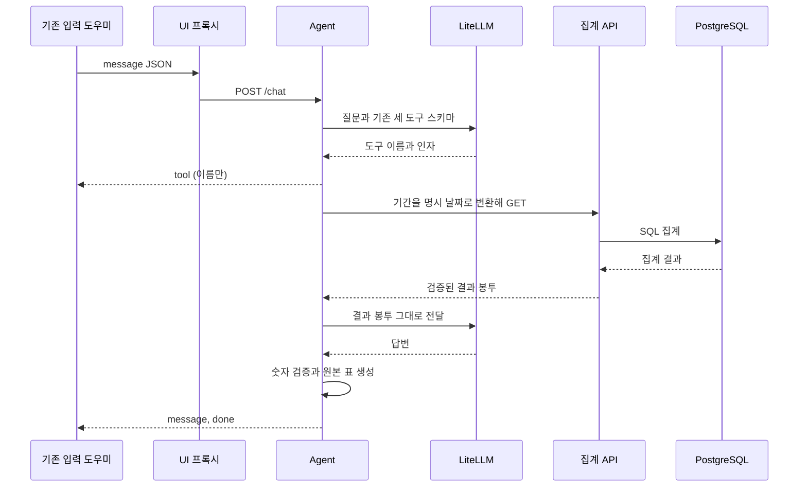

# 대화 통계 모델 연결

## 1. 모델 포트

agent의 LanguageModel.call_tools는 메시지·기존 도구 JSON Schema·남은 시간을 받고 응답과 USD 추정 비용을 반환한다. 서버의 거래 추출/complete_json 경로는 유지한다. 승인된 LiteLLM 1.106.6을 agent에만 추가한다.

현재 API에 연결된 search_transactions, count_frequency, compare_periods만 모델에 노출한다. 나머지 세 계약은 미구현 API가 준비될 때까지 제외한다. 기존 oneOf 스키마를 바꾸지 않으며 strict:false와 실행기 검증을 사용한다. 병렬 호출과 LiteLLM/제공자 SDK 재시도를 모두 끈다. 비용을 알 수 없으면 실패한다.

참고: [LiteLLM 도구 호출](https://docs.litellm.ai/docs/completion/function_call), [비용](https://docs.litellm.ai/docs/completion/token_usage), [OpenAI 도구 호출](https://developers.openai.com/api/docs/guides/function-calling).

각 단계의 단위 테스트는 모델 대역을 사용한다. 실제 모델 평가는 integration 표식으로 분리한다.

## 2. 제한된 ReAct 조회 루프

AGENT_MAX_STEPS 기본 8, AGENT_MAX_COST_USD 기본 0.50을 사용한다. 요청 시간은 20초이며 새 환경 상한은 만들지 않는다. 도구 없는 응답·단계/비용/시간 한도·같은 이름과 정규화 인자 반복에 종료한다. 한도에서는 완료된 관측값만 남긴다. 비용은 사용량 기반 추정치로, 단일 호출 비용이 상한을 넘을 수 있으나 다음 작업을 시작하지 않는다. 도구 오류도 원래 결과 봉투로 모델에 전달하며 0으로 치환하지 않는다. 모델은 query 읽기 도구만 사용하고 쓰기 확인 상태는 이번 범위에 없다.

## 3. 수치 검증

성공한 관측값의 수치 필드만 설명의 근거로 인정한다. 쉼표·소수·부호를 정규화하고 정확한 Decimal 값으로 대조한다. 검증되지 않은 숫자가 하나라도 있으면 문장 전체를 버리고 원본 표를 유지한다. 서버가 확인한 날짜와 내부 종료 제외 경계를 포함 종료일로 바꾼 날짜만 예외로 인정한다. 메모·사용처에 적힌 숫자는 통계 근거가 아니다. 빈 조회와 실패를 구분하며 일부 도구가 실패하면 성공한 표만 표시한다. 이는 숫자 일치 검사이며 문장 전체의 의미적 진실성을 증명하는 장치는 아니다.

## 4. HTTP 경계

stdlib HTTP 서버의 POST /chat은 tool → message → done SSE를 제공한다. 오류는 request_id가 있는 공개 봉투로만 전송하고 원본 모델 예외·거래 문장·키를 로그에 남기지 않는다. 도구 이벤트에는 이름만 포함한다. 입력 제한·이벤트 상세는 [API 계약](../api-contract.md#구현된-채팅-sse-계약)이 기준이다. Compose agent는 외부 포트를 공개하지 않으며 API HTTP만 호출하고 DB에 직접 접근하지 않는다.

## 5. UI 호출 선택

서버 전용 AGENT_BASE_URL이 있으면 기존 입력 도우미가 ChatAgent를 사용한다. 없으면 각본형 체험을 유지한다. 브라우저에는 enabled 불리언만 노출하며 내부 주소·키·거래 전체를 전달하지 않는다. 실제 호출의 실패를 각본형 성공으로 대체하지 않는다. 화면 배치는 유지하고 호출 선택과 체험/실제 연결 모두에 맞는 안내 문구만 바꾼다. 표는 기존 답변 상세 영역에 표시한다. 개발 Compose에도 같은 프록시와 설정을 연결했다.

## 6. 평가와 실행

agent/evaluation/questions.json은 단일 조회 15·기간 8·복합 4·거절 3건의 합성 질문이다. 기본 테스트는 가짜 모델로 실행 흐름을 검증하며 자연어 이해 성능을 증명하지 않는다. 실제 모델 선택·인자·수치 평가는 명시적으로 `python -m pytest -m integration agent/tests/evaluation`을 실행한다. 키가 프로세스에 주입되지 않으면 건너뛴다. 테스트 자체가 .env를 읽지 않는다. 실제 가계부 대신 합성 API만 사용한다.

전체 검증은 `make all`, Windows에서는 동일 구현인 `python scripts/check_all.py`다. 실제 모델 평가는 별도이며 일반 검증에서 비용을 발생시키지 않는다. 현재 실제 모델 평가는 실제 .env 접근 금지에 따른 승인 검토 거절로 실행하지 못했다. oneOf 스키마의 실제 제공자 수용 여부도 그 평가에서 확인해야 한다.

| 환경 변수 | 위치 | 기본값 |
| --- | --- | --- |
| AGENT_BASE_URL | UI 서버 | 없음(각본형); Compose는 http://agent:8001 |
| API_BASE_URL | agent | http://api:8000 |
| AGENT_MODEL | agent | gpt-4.1-mini |
| AGENT_MAX_STEPS | agent | 8 |
| AGENT_MAX_COST_USD | agent | 0.50 |
| OPENAI_API_KEY | agent/API | 기존 비밀값, 브라우저 노출 금지 |

후속 SSE 재개·인증·대화 기억·쓰기·요약/예산/이상치 API는 별도 작업이다. 기존 도구 스키마는 변경하지 않았다.

컨테이너는 LITELLM_LOCAL_MODEL_COST_MAP=True로 패키지의 비용표를 사용해 시작 시 원격 비용표 다운로드와 재시도를 피한다. 이는 추정 비용이며 실제 청구와 다를 수 있다. scripts/smoke_chat.py는 키와 외부 네트워크 없이 HTTP SSE부터 모델 어댑터·루프·도구 실행·수치 검증까지 합성 자료로 확인한다.

최종 검증: Python 319건 통과, 기존 PostgreSQL 통합 22건은 DB 미설정으로 스킵, 실제 모델 30건은 기본 실행에서 제외했다. UI 79건, 린트·타입 검사·빌드·문서 검사와 컨테이너의 합성 HTTP SSE 요청이 통과했다. 린트에는 기존 badge Fast Refresh 경고 하나가 남는다. Windows에서는 make 실행 파일이 없어 동일한 scripts/check_all.py를 각 커밋 전에 실행했다. 실제 모델 평가는 미완료이며 그 성공을 주장하지 않는다.
