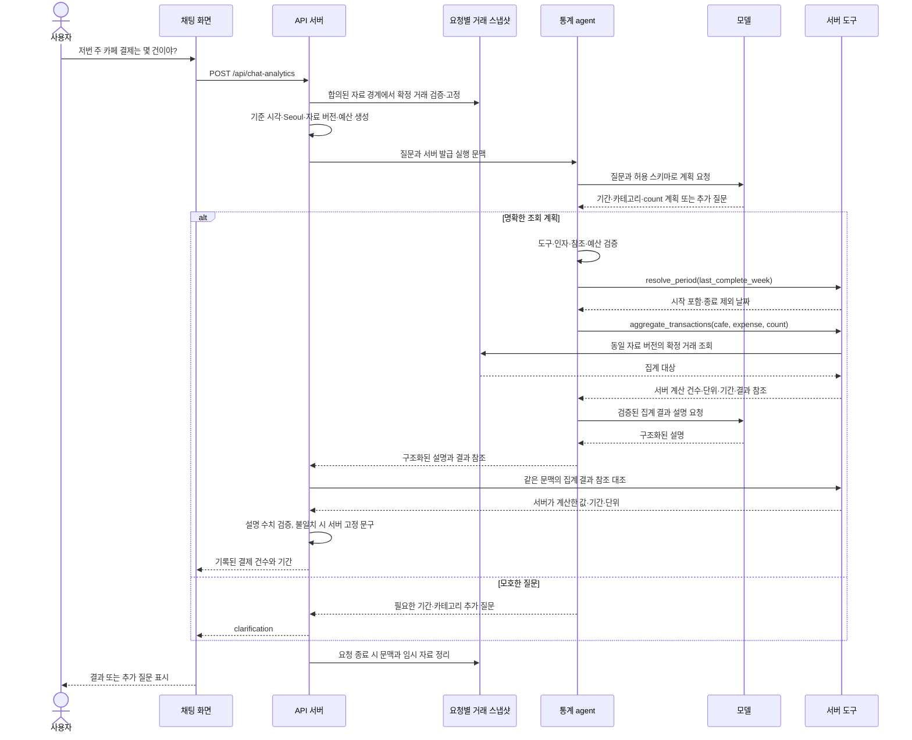

# 채팅 통계 구현 계획 초안

이 문서는 기존 AI 브랜치 통합 이후의 구현 제안이다. 이번 통합에서 통계 코드는 구현하지 않는다. [채팅 통계](chat-statistics.md), [공통 도구](tools.md), [에이전트 구조](agent-architecture.md), [Plan-and-Execute](plan-and-execute.md)를 기준으로 한다.

## 먼저 결정할 설계 차이

| 문서의 전제 | 현재 구현 | 구현 전에 필요한 결정 |
| --- | --- | --- |
| 인증된 사용자 범위와 거래 스냅샷 | 인증 없음, 거래 원본은 브라우저 localStorage | 인증·서버 거래 저장을 선행할지, 개인 실습용 요청 스냅샷으로 범위를 조정할지 결정 |
| 서버가 확정 거래의 날짜·금액을 집계 | pgvector에는 최소 검색 문서만 저장 | pgvector를 통계 원본으로 쓰지 않고 별도 거래 입력 경계를 마련 |
| 별도 에이전트가 서버 도구를 HTTP로 호출 | 현재 거래 AI는 API 서버가 OpenAI 직접 호출 | 새 통계 흐름에만 별도 agent 서비스를 추가하고 기존 AI 경로 유지 |
| 공통 도구에 복합 비교 포함 | 채팅 통계 이슈의 핵심은 단일 기간 조회 | 첫 구현은 count/sum 조회로 제한하고 비교·규칙은 후속 기능으로 분리 |

첫 번째 결정은 미승인 상태다. 인증을 이번 작업에 포함하지 않는다면, **개인 실습용으로 요청마다 확정 거래의 최소 필드를 전달하고 서버가 검증해 불변 스냅샷을 만드는 방식**을 제안한다. 이 경우 사용자 소유권을 검증한 자료라는 주장을 하지 않으며 공통 도구 문서의 적용 범위 조정을 먼저 승인받는다. dataset_id를 인증 정보로 취급하지 않는다. 자료는 요청 처리 동안만 유지하고 모델에는 거래 목록을 전달하지 않는다.

인증·서버 원본 방식을 선택하면 아래 1단계 전에 인증과 거래 저장·동기화 설계를 별도 feature로 확정해야 한다. 현재 RAG의 최근 100건을 통계 전체 자료처럼 사용하거나, 366일 범위를 넘어서는 자료를 조용히 잘라 집계하지 않는다. 요청 크기·거래 수 제한과 초과 오류는 자료 경계 결정 시 함께 확정한다.

## feature 분할

아래 네 feature는 자료 경계 합의 후 develop 기준으로 순차 진행한다. 실제 모델 호출은 마지막 feature에만 추가한다.

| 순서 / 브랜치 | 변경 서비스 | 구현·완료 기준 |
| --- | --- | --- |
| 1. feature/chat-statistics-tools | server, tests, 계약 문서 | 요청별 고정 시각·스냅샷·결과 참조 문맥, 카테고리 조회, 기간 계산, count/sum 집계와 내부 HTTP 도구 경계. 모델 없이 합성 거래로 검증 |
| 2. feature/chat-statistics-agent | agent, server, Compose, tests | 별도 agent 서비스와 내부 HTTP 클라이언트, 모델 대역, 허용 도구 실행·취소·예산·응답 수치 검증. 고정 계획으로 전체 흐름 검증 |
| 3. feature/chat-statistics-ui | ui, server, tests, UI 문서 | 통계 요청 API와 실제 화면 연결. 명시적인 기간·카테고리·지표 선택으로 모델 없이 사용. 각본 응답과 구분하고 근거·단위·정상 0·오류 표시 |
| 4. feature/chat-statistics-model | agent, server, ui, Compose, tests, AI 문서 | 자연어 질문을 구조화된 도구 계획으로 해석하고 검증된 결과만 설명. 모호하면 추가 질문. 실제 모델 호출·거절·타임아웃 smoke 검증 |

범위는 완료된 주·월, 수입/지출, 카테고리, 건수/합계와 선택적 날짜·카테고리 그룹이다. 비교 계산·sum_and_count·규칙 평가·MCP·예약 알림은 후속 작업으로 둔다. 기존 거래 채우기·카테고리 추천 경로는 유지한다. 새 라이브러리와 LiteLLM 도입은 필요성 확인 후 별도 합의하며 이번 통합에 의존성을 추가하지 않는다.

## 제안 인터페이스

다음은 구현 전 계약을 확정할 제안이며 현재 사용 가능한 API 목록이 아니다. 실행 문맥은 서버가 생성하고 모델 인자로 받지 않는다. 내부 엔드포인트는 호스트에 포트를 공개하지 않고 요청 문맥 검증을 적용한다. 내부 통신의 호출자 검증 방법은 자료·인증 경계와 함께 확정한다.

| 종류 | 이름 | 목적 / 주요 입력·출력 |
| --- | --- | --- |
| 공개 API | POST /api/chat-analytics | 3단계의 구조화 조회, 4단계의 자연어 질문. answer/clarification/error와 적용 기간·유형·카테고리·지표·단위·자료 버전 반환 |
| agent 내부 API | POST /internal/chat-analytics/execute | API 서버가 질문 또는 명시적 조회 조건과 서버 발급 요청 문맥을 전달. agent는 원본 거래를 받지 않음 |
| 서버 내부 API | POST /internal/tools/{tool_name} | 동일 요청의 문맥에서 허용된 아래 도구만 실행. 만료·다른 요청의 참조·쓰기 도구 거부 |
| 도구 | list_categories | income/expense에 허용된 카테고리 반환 |
| 도구 | resolve_period | last_complete_week/previous_complete_week/last_complete_month/previous_complete_month → 시작 포함·종료 제외 날짜 |
| 도구 | aggregate_transactions | 기간·유형·카테고리·metric(count/sum)·group_by(null/category/date) → 서버 계산 값·단위·result_id·data_version |
| 환경 변수 | AGENT_BASE_URL | API 서버가 호출할 내부 agent 주소 |
| 환경 변수 | TOOLS_BASE_URL | agent가 호출할 내부 서버 도구 주소 |
| 환경 변수 | OPENAI_CHAT_ANALYTICS_MODEL | 마지막 feature에서 사용하는 통계 질문 해석·설명 모델 |
| 기존 환경 변수 | OPENAI_API_KEY | 마지막 feature에서 기존 키 설정을 재사용. 실제 .env는 읽거나 커밋하지 않음 |

에이전트는 서버 Python 소스를 직접 import하지 않는다. 허용 도구는 조회 전용이며 원문 메모·SQL·코드·사용자 ID·임의 URL을 받지 않는다. 공통 계약의 최대 366일·366그룹, 요청당 도구 6회·모델 최대 3회·전체 20초를 적용한다. 모델 호출은 보통 계획 1회와 설명 1회로 끝내며 무한 재시도하지 않는다. 초기 모델은 기존 프로젝트에서 사용하는 모델을 기본으로 하고 별도 모델 선정 시 비용·지원 여부를 확인한다.

## 요청 하나의 흐름

아래는 자료 경계 합의 후의 마지막 feature 흐름이다. 1~3단계에서는 모델을 호출하지 않고 명시적 조건과 대역으로 동일 경계를 검증한다.

## 검증과 완료 기준

- 고정 시각으로 월요일·일요일·월말·연말과 시작 포함/종료 제외를 검증한다. 지난 7일을 저번 주로 바꾸지 않는다.
- 같은 날 결제 두 건을 두 건으로 계산하고 초안·다른 유형·카테고리는 제외한다. 실제 방문 횟수라고 표현하지 않는다.
- 정상 빈 결과는 0, DB·HTTP·모델 장애는 구분된 실패다. 요청 취소·만료·예산 소진 뒤 후속 도구를 실행하지 않는다.
- 동시 요청·다른 문맥의 결과 ID·자료 버전 변경·알 수 없는 필드·SQL·쓰기 도구를 거부한다. 모델 대역의 수치 변조는 서버 결과로 교체하거나 차단한다.
- 1~3단계는 모델 호출이 0회임을 대역으로 검증한다. 4단계에서만 실제 모델을 연결해 정상·모호함·거절·시간 초과를 확인한다.
- 각 feature마다 Python·UI 테스트, 타입 검사·린트·빌드·문서 검증을 실행한다. 기존 수동 입력과 추출 → RAG 순서·부분 실패 유지도 회귀 검증한다.

이번 계획의 중단 지점은 자료·인증 경계 결정이다. 이 합의 없이 통계 구현을 시작하거나 인증 문서를 임의 변경하지 않는다.
