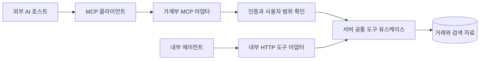

# 외부 AI를 위한 가계부 MCP 통로

외부 AI 호스트가 가계부의 공통 도구를 발견하고 호출할 수 있도록 하는 설계다.
현재 MCP 서버·인증 서버·외부 연결은 구현되지 않았다. 아래 주소와 메시지는 교육용 예시다.
설계 기준은 확인한 MCP 2025-11-25 명세이며 연동 시 클라이언트 지원 버전을 협상한다.

## 연결 구조와 책임



외부 모델은 MCP 클라이언트를 가진 호스트를 통해 연결한다.
MCP 어댑터는 [공통 도구](tools.md)의 JSON Schema·메서드·결과 형식만 변환하고
계산·권한 판정은 서버 유스케이스를 재사용한다.
DB 연결 정보·내부 서비스 토큰·직접 SQL 접근을 외부 AI에 제공하지 않는다.
브라우저의 localStorage 자료는 서버 자료가 아니므로 현재 UI 기록을 MCP가 읽을 수 없다.

## 초기 노출 범위

조회 전용 실습의 초기 노출은 `list_categories`, `resolve_period`,
`aggregate_transactions`, `list_statistic_rules` 네 도구다.
원문 메모를 반환하는 RAG, 초안을 저장하는 `prepare_transaction`,
결과 참조가 필요한 비교 도구는 초기 외부 목록에서 제외한다.
확장할 때 별도 권한과 문맥 수명 계약을 정의한다.
외부 호스트가 두 집계값을 비교해 설명할 수 있지만 그 설명은 서버의 검증된 비교 결과가 아니다.
서버 검증 비교가 필요하면 후속 전용 비교 유스케이스를 정의한다.

단일 사용자 로컬 실습과 원격 서비스의 사용자 인증은 별도 단계다.
MCP를 도입한다고 기존 HTTP API의 다중 사용자 권한이 자동 구현되지는 않는다.

## 도구 발견과 호출

[공식 lifecycle](https://modelcontextprotocol.io/specification/2025-11-25/basic/lifecycle)에 따라
initialize로 버전·capability를 협상하고 initialized 알림 후 도구를 사용한다.
서버는 tools capability를 선언한다. 초기 고정 목록에는 listChanged를 선언하지 않는다.

[공식 도구 명세](https://modelcontextprotocol.io/specification/2025-11-25/server/tools)의
`tools/list`는 도구 정의, `tools/call`은 실행 요청이다.
아래는 목록 결과의 한 도구 예시다. 기간 enum 전체는 [도구 계약](tools.md)에 정의한다.

```json
{
  "name": "resolve_period",
  "description": "서버 기준 시각으로 완료된 주 또는 월의 날짜 범위를 계산합니다.",
  "inputSchema": {
    "type": "object",
    "properties": {
      "period": {"type": "string", "enum": ["last_complete_week", "previous_complete_week", "last_complete_month", "previous_complete_month"]}
    },
    "required": ["period"],
    "additionalProperties": false
  },
  "annotations": {"readOnlyHint": true, "destructiveHint": false}
}
```

annotations는 클라이언트의 참고 정보다. 실제 쓰기 차단과 권한 검사를 대체하지 않는다.
기준 시각 `2026-10-13T12:00:00+09:00`에서의 호출과 응답 예시는 다음과 같다.

```json
{
  "jsonrpc": "2.0",
  "id": 2,
  "method": "tools/call",
  "params": {"name": "resolve_period", "arguments": {"period": "last_complete_week"}}
}
```

```json
{
  "jsonrpc": "2.0",
  "id": 2,
  "result": {
    "content": [{"type": "text", "text": "{\"period_start\":\"2026-10-05\",\"period_end_exclusive\":\"2026-10-12\",\"timezone\":\"Asia/Seoul\"}"}],
    "structuredContent": {"period_start": "2026-10-05", "period_end_exclusive": "2026-10-12", "timezone": "Asia/Seoul"},
    "isError": false
  }
}
```

structuredContent는 서버 도구 결과이며 모델의 구조화 출력과 구분한다.
호환성을 위해 같은 JSON의 text content도 반환한다.
outputSchema를 제공하면 성공 결과를 그 스키마로 검증한다.
그다음 집계 호출의 arguments는 [집계 예시](tools.md#요청과-결과-예시)와 동일하다.

## 로컬 실습과 원격 연결

[공식 전송 명세](https://modelcontextprotocol.io/specification/2025-11-25/basic/transports)에 따라
로컬 stdio는 클라이언트가 서버 프로세스를 실행하고 줄 단위 JSON-RPC를 주고받는다.
stdout에는 프로토콜 메시지만 쓰고 로그는 stderr로 보낸다.
실습은 합성 자료와 사용자 범위가 고정된 로컬 프로세스로 시작한다.
명령과 패키지는 서버 구현 후 확정하며 지금 실행 가능한 설정을 제공하지 않는다.

원격 클라우드 호스트에는 stdio나 사용자의 localhost가 직접 연결되지 않는다.
후속 원격 어댑터는 HTTPS Streamable HTTP의 단일 `/mcp` 엔드포인트로 설계한다.
JSON POST 응답 또는 SSE를 지원하고 GET 스트림을 제공하지 않으면 405로 응답한다.
HTTP+SSE 구형 전송과 혼동하지 않는다. Origin 검증과 로컬 실행 시 loopback 바인딩을 적용한다.
연결 끊김을 취소로 간주하지 않고 명시적 취소를 처리한다.
공개 배포·터널 생성·실제 서비스 등록은 이번 문서 작업에 포함하지 않는다.

## 인증과 사용자 범위

원격 실거래 조회에는 [공식 HTTP 인가 명세](https://modelcontextprotocol.io/specification/2025-11-25/basic/authorization)에
맞는 인가 기반을 구현한다. OAuth 기반 사용자 승인과 보호 리소스 메타데이터,
인증 서버 발견, 토큰의 audience·만료·권한 검증을 설계한다.
stdio의 자격증명 전달은 HTTP OAuth 흐름과 구분한다.

가계부 정책의 초기 scope는 `ledger:read`로 제안한다. 도구 인자의 사용자 ID는 거부하고
서버가 토큰의 주체와 사용자 자료 범위를 연결한다.
`tools/list`도 인증·scope에 따라 필터링하고, 호출 시 다시 확인한다.
내부 서비스 토큰은 외부 사용자 인증을 대신하지 않는다.
외부 토큰을 내부 API에 그대로 전달하는 token passthrough를 하지 않는다.
MCP 세션 ID는 인증 자격증명이 아니며 각 요청을 인증한다.
실제 토큰·키·거래 원문을 문서나 로그에 넣지 않는다.

## 오류 처리

잘못된 JSON-RPC 메시지·미지원 메서드·알 수 없는 도구는 프로토콜 오류다.
아래는 알 수 없는 도구의 예시다.

```json
{"jsonrpc": "2.0", "id": 3, "error": {"code": -32602, "message": "Unknown tool"}}
```

인식된 도구의 날짜 검증 실패·DB 장애 같은 실행 오류는 result의 isError로 구분한다.

```json
{
  "jsonrpc": "2.0",
  "id": 4,
  "result": {
    "content": [{"type": "text", "text": "{\"error\":{\"code\":\"INVALID_ARGUMENT\",\"message\":\"조회 기간을 확인하세요.\"}}"}],
    "isError": true
  }
}
```

HTTP 인증 실패는 401, 권한 부족은 403으로 처리하며 인가 발견에 필요한 응답을 제공한다.
도구 오류를 정상 빈 집계로 변환하지 않는다.
독립 호출마다 시간·조회 범위를 제한하고 사용자·클라이언트별 요청률 제한을 별도로 둔다.
내부 에이전트의 요청당 6회 제한만으로 외부 호스트의 반복 호출을 제어할 수는 없다.
로그는 요청 ID·도구·시간·오류 코드만 기록하고 거래 메모·토큰을 제외한다.

## 교육 실습과 완료 기준

1. 합성 자료로 stdio 초기화 → tools/list → 기간 계산 → 집계를 실행한다.
2. MCP와 내부 HTTP의 동일 인자가 같은 서버 집계값을 반환하는지 시험한다.
3. 잘못된 타입·알 수 없는 필드·사용자 ID 삽입·미허용 쓰기 도구를 차단한다.
4. JSON-RPC 오류와 실행 오류, 빈 결과와 DB 장애를 구분한다.
5. 원격 단계에서 무인증·만료 토큰·잘못된 audience·scope 부족·세션 사용자 혼합,
   악성 Origin·취소·반복 호출 한도를 시험한다.

외부 AI 서비스별 지원 전송·버전·인증·등록 방식은 연결 시 공식 문서로 확인한다.
MCP 명세를 지원한다고 모든 AI 서비스가 자동 접속하는 것은 아니다.
현재 검증은 Markdown 링크와 JSON 예시 형식이며 프로토콜 상호운용 테스트는 후속 구현 과제다.
