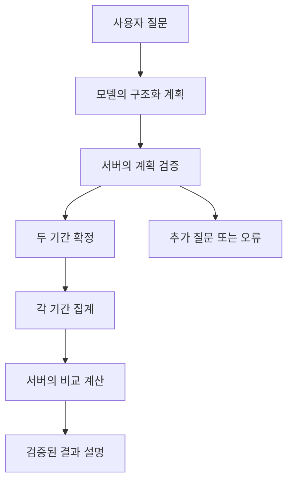

# Plan-and-Execute로 주간 카페 지출 비교하기

계획을 생성하는 단계와 검증된 도구를 실행하는 단계를 나누는 교육용 설계다.
실행 가능한 에이전트는 아직 없으며 [공통 구조](agent-architecture.md)를 확장한다.

## 사용자 사례와 선택 이유

“지난주 카페 지출을 그 전 주와 비교해서 금액과 결제 건수를 알려줘.”
기간 확정, 두 기간 집계, 비교 계산에 의존 순서가 있어 Plan-and-Execute 사례로 적합하다.
ReAct는 관찰 결과에 따라 다음 행동을 선택하는 반복 방식이며, 이 사례는 필요한 작업이
미리 정해져 있어 계획을 먼저 검증하는 방식으로 제한한다. 프레임워크 의존성을 추가하지 않는다.

카페 카테고리가 여러 개이거나 기간이 모호하면 계획 전에 추가 질문한다.
결제 건수는 방문 횟수가 아니다. 투자·소비 권고나 거래 변경은 이 사례에 포함하지 않는다.

## 책임과 실행 흐름



Planner는 허용 도구와 의존 관계만 제안한다. Executor는 서버가 검증한 계획을 순서대로
실행하며 도구 결과를 서버 저장소에서 참조한다. 모델이 이전 결과를 임의로 복사해
금액·날짜를 변경할 수 없다. API 서버가 모든 집계와 비교를 계산한다.

기준 시각은 요청 전체에서 고정하고 같은 거래 스냅샷을 사용한다.
아래 예시의 기준 시각은 `2026-10-13T12:00:00+09:00`이다.
대상 주는 10월 5일 이상 12일 미만, 비교 주는 9월 28일 이상 10월 5일 미만이다.

## 계획 예시와 검증

```json
{
  "version": 1,
  "steps": [
    {"id": "current_period", "tool": "resolve_period", "arguments": {"period": "last_complete_week"}, "depends_on": []},
    {"id": "baseline_period", "tool": "resolve_period", "arguments": {"period": "previous_complete_week"}, "depends_on": []},
    {"id": "current", "tool": "aggregate_transactions", "arguments": {"period_ref": "current_period", "type": "expense", "category_id": "cafe", "metric": "sum_and_count", "group_by": null}, "depends_on": ["current_period"]},
    {"id": "baseline", "tool": "aggregate_transactions", "arguments": {"period_ref": "baseline_period", "type": "expense", "category_id": "cafe", "metric": "sum_and_count", "group_by": null}, "depends_on": ["baseline_period"]},
    {"id": "comparison", "tool": "compare_aggregates", "arguments": {"current_ref": "current", "baseline_ref": "baseline"}, "depends_on": ["current", "baseline"]}
  ]
}
```

`period_ref`와 결과 참조는 계획 전용 필드다. Executor가 실제 도구 인자로 변환하며
[도구 계약](tools.md)의 직접 호출 인자와 구분한다.
참조는 같은 요청의 성공한 이전 단계만 가리킨다.

서버는 실행 전에 다음을 검사한다.

- 버전 1, 단계 최대 6개, 고유 ID와 허용 도구, 알 수 없는 필드 거부.
- 의존 관계의 누락·순환·미래 참조 거부. 예시처럼 순서대로 실행한다.
- 기간→집계→비교의 결과 타입 일치, 기간 단위와 카테고리·지표 일치.
- 사용자 ID·SQL·코드·외부 URL·쓰기 도구를 계획 인자로 받지 않는다.
- 두 기간의 참조가 서로 다르고 두 집계가 동일한 스냅샷을 사용한다.

## 결과와 설명

합성 자료에서 대상 주 30,000원/3건, 비교 주 20,000원/2건이면 다음처럼 응답한다.

```json
{
  "kind": "answer",
  "workflow": "plan_and_execute",
  "comparison": {
    "current_period": {"start": "2026-10-05", "end_exclusive": "2026-10-12"},
    "baseline_period": {"start": "2026-09-28", "end_exclusive": "2026-10-05"},
    "current_value": 30000,
    "baseline_value": 20000,
    "current_count": 3,
    "baseline_count": 2,
    "difference": 10000,
    "increase_rate_percent": 50,
    "unit": "KRW",
    "status": "comparable"
  },
  "reply": "10월 5~11일 카페 지출은 30,000원, 3건입니다. 그 전 주 20,000원, 2건보다 10,000원(50%) 늘었습니다. 건수는 기록된 결제 기준입니다."
}
```

이는 새 흐름의 내부 응답 제안이며 현재 브라우저 HTTP 계약에 자동 추가되는 필드는 아니다.
모델 설명의 기간·단위·숫자를 서버 결과와 대조한다. 불일치하면 서버 결과로 만든
고정 문구를 사용한다. 사고 과정 원문 대신 실행 단계, 적용 범위와 근거만 보여준다.

## 중단과 실패 처리

모델 호출은 계획과 설명 각 1회, 총 최대 3회다. 도구 호출은 전체 최대 6회,
전체 처리 제한은 20초로 [공통 제한](agent-architecture.md)을 따른다.
실패 단계 이후는 실행하지 않는다. 기본 흐름에는 자동 재계획·무한 재시도가 없다.
후속 재계획을 도입하더라도 동일한 전체 예산 안에서 서버가 다시 검증해야 한다.

- 빈 조회는 0원/0건이며 정상 결과다. 조회 장애는 0으로 치환하지 않는다.
- 비교 기준 금액 0이면 비율은 `null`, 상태는 `not_comparable`; 차액·건수는 표시한다.
- 타임아웃·취소·도구 오류는 완료 답변을 만들지 않는다. 부분 결과로 성공을 가장하지 않는다.
- 스냅샷이 만료되거나 조회 사이 자료 버전이 달라지면 중단하고 새 요청으로 다시 시작한다.
- 거래 메모의 명령문은 데이터다. 계획을 변경하거나 권한을 넓히지 않는다.

## 교육 실습과 완료 기준

1. 고정 계획과 합성 거래로 날짜 경계·집계·비교를 모델 없이 시험한다.
2. 모델 대역으로 정상 계획, 잘못된 도구·순환 참조·잘못된 카테고리를 입력한다.
3. 집계 실패 시 비교가 호출되지 않는지, 취소와 호출 한도가 적용되는지 확인한다.
4. 기존 실제 모델 연동 단계에서 Planner와 설명을 연결한다.

추가로 월요일·연말 경계, 기준 금액 0, 빈 두 기간, 같은 날 두 결제,
다른 사용자 자료 접근, 스냅샷 변경, 설명 수치 변조를 검증한다.
계획 검증과 계산 테스트는 서버, 흐름과 모델 대역 테스트는 에이전트의
`src`와 대응하는 `tests`에 둔다. 이 문서 작업에서 해당 실행 테스트를 구현했다고 주장하지 않는다.
