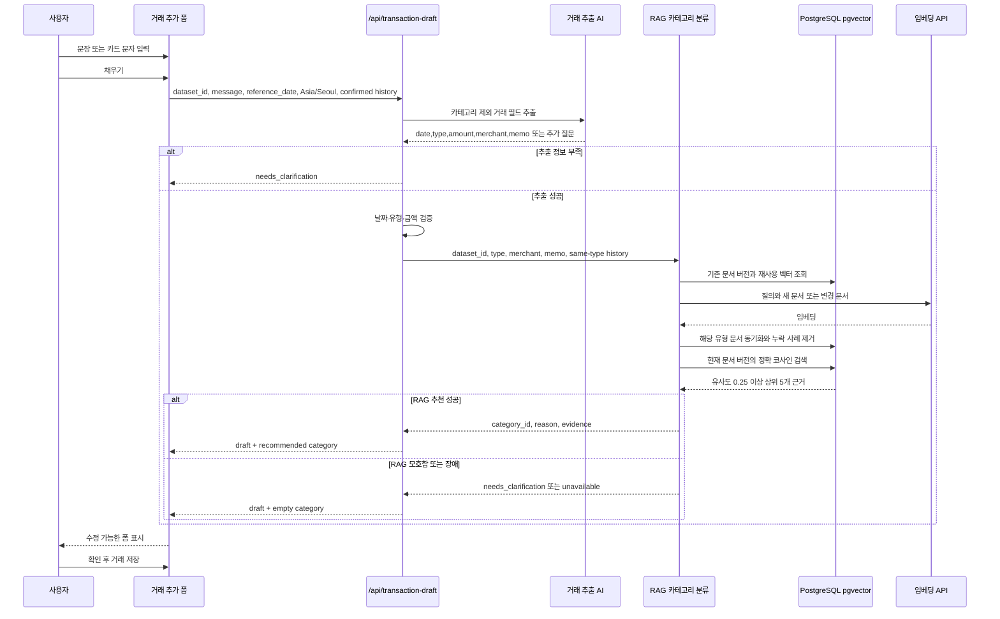

# 거래 채우기 AI 파이프라인

거래 추가 폼의 **채우기**는 한 번의 사용자 행동으로 두 단계를 순서대로 실행한다. 먼저 거래 추출 AI가 날짜·유형·금액·사용처·메모를 만들고, 서버 검증을 통과한 뒤 RAG 카테고리 분류가 카테고리 정의와 확정 거래 근거를 검색해 추천한다.

## 요구사항 원문

```text
그럼 채우기를 누르면 거래 추출 AI랑 RAG 카테고리 분류가 순서대로 호출되도록 해줘. 설계 문서랑 mermaid도 같이 반영해줘
```

## 처리 순서



추출 모델은 카테고리를 결정하지 않는다. 카테고리는 RAG 결과가 `recommended`일 때만 초안에 채워진다. RAG가 모호하거나 사용할 수 없으면 초안은 유지하고 카테고리는 사용자가 선택한다.

브라우저는 자료 구분 UUID를 유지하며 `dataset_id`를 필수로 전달한다. 이 값은 자료 구분용이며 인증 수단이 아니다. 거래 원본은 브라우저에 유지하고 검색 자료·임베딩만 DB에 저장한다. 같은 자료 구분·유형에서 요청에 빠진 사례는 제거하므로 수정·삭제는 다음 AI 요청에 반영된다. 텍스트 해시·모델·차원·문서 형식이 같으면 임베딩을 재사용하고 카테고리만 바뀌면 메타데이터만 갱신한다. 질의는 매번 임베딩한다. 자세한 저장·검색 규칙은 [RAG 구현 문서](category-rag-implementation.md)를 참고한다.

## 검증과 취소

서버는 `message` 4,000자, 확정 거래 100건, 요청 본문 200KB를 넘지 않게 제한한다. 추출 응답의 날짜는 실제 달력 날짜여야 하고 금액은 양의 정수 원화여야 한다. UI는 응답 도착 시점에 확정 거래 근거를 다시 검증한다.

입력값 변경, 유형·금액·카테고리 직접 수정, 폼 닫기는 진행 중인 채우기 응답을 무효화한다. 저장은 여전히 사용자가 거래 폼의 저장 버튼을 눌렀을 때만 발생한다.
