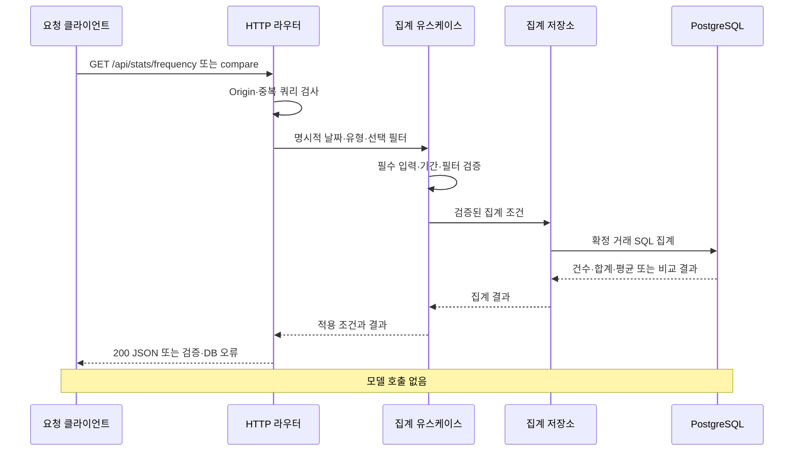

# 가계부 API 계약 초안

이 문서는 UI·API 서버·에이전트의 목표 HTTP 계약을 정한다. 현재 실행 가능한 경로는 `GET /api/health`, 카테고리 조회, 거래 CRUD·가져오기, 빈도·기간 비교 집계와 두 AI POST 경로다. 월별 합계·채팅·초안 확인·내부 도구 경로는 후속 설계다. 거래 저장·이전의 범위와 실행법은 [서버 거래 저장](server-ledger.md)을 따른다. 실제 AI 요청·응답 예시는 [RAG 구현 문서](ai/category-rag-implementation.md)에 있다. 사용 화면과 정상 응답의 자세한 JSON 예시는 [가계부 설계 문서](agent-account-book-design.md#입력과-출력-예시)에 있다. 아래 계약은 초기 로컬 단일 사용자 버전에 적용하며, 구현 과정에서 바꾸면 두 문서를 함께 갱신한다.

## 공통 규칙

- 브라우저는 UI 서버의 같은 출처에서 `/api/...`를 호출한다. UI 서버는 이 경로만 API 서버로 전달하며 `/internal/...`은 프록시하지 않는다.
- 요청과 응답 본문은 JSON이며 금액은 양의 정수 원화다. `type`은 `income` 또는 `expense`로 표현한다.
- 거래일은 `YYYY-MM-DD`, 월은 `YYYY-MM`으로 전달한다. “오늘”과 “이번 달”은 API 서버가 전달한 Asia/Seoul 기준 시각으로 해석한다.
- 현재 구현은 로컬 단일 사용자다. 두 AI 요청의 `dataset_id`는 브라우저가 유지하는 필수 UUID이며 검색 자료 구분에만 사용한다. 인증·사용자 권한을 보장하지 않는다. 향후 인증된 서비스의 사용자 ID와 구분한다. 거래 원본은 PostgreSQL의 단일 개인 가계부에 저장하며 같은 서버에 접속한 모든 브라우저가 공유한다. 거래 API는 dataset_id나 사용자 ID를 입력으로 받지 않는다. 로그인과 다중 사용자 권한은 초기 범위 밖이다.
- 브라우저가 변경을 요청하는 경로는 JSON만 받고 요청 출처를 로컬 UI 주소와 대조한다. 초기 버전에서 다른 출처의 브라우저 요청을 허용하는 CORS 설정은 사용하지 않는다.
- 거래 또는 초안의 ID는 불투명한 문자열이다. UI는 ID의 형식이나 순서를 해석하지 않는다.
- 예시에 없는 필드는 기본적으로 거부한다. 수입·지출 종류, 금액, 카테고리, 날짜를 서버가 검증한다.

## 브라우저용 경로

| 경로 | 입력 | 성공 응답 | 주요 실패 |
| --- | --- | --- | --- |
| `GET /api/categories` | 입력 없음 | `200` 사용할 수 있는 수입·지출 카테고리 목록 | `500` 서버 오류 |
| `GET /api/transactions` | `from`, `to`, `type`, `category_id`, `merchant`, `limit`, `cursor` 선택 | `200` 거래 목록과 다음 커서 | `422` 잘못된 필터 |
| `POST /api/transactions` | 거래일, 유형, 금액, 통화, 카테고리, 사용처, 메모 | `201` 저장된 거래 | `422` 잘못된 필드 또는 카테고리 |
| `PATCH /api/transactions/{id}` | 변경할 거래 필드만 | `200` 수정된 거래 | `404` 없는 거래, `422` 잘못된 변경 |
| `DELETE /api/transactions/{id}` | 본문 없음 | `204` 본문 없음 | `404` 없는 거래 |
| `POST /api/transactions/import` | 기존 거래의 `items` 배열, 최대 100건 | `200` 가져온 건수와 건너뛴 건수 | `422` 잘못된 거래, `409` ID 충돌, `503` DB 장애 |
| `GET /api/stats/frequency` | 필수 `from`, `to`, `type`; 선택 `category_id`, `merchant` | `200` 결제 건수·거래 날짜 수·평균 간격·회당 평균 금액 | `422` 잘못된 필터, `503` DB 장애 |
| `GET /api/stats/compare` | 필수 `a_from`, `a_to`, `b_from`, `b_to`, `type`; 선택 `category_id` | `200` 카테고리별 두 기간 합계·차액·증감률 | `422` 잘못된 필터, `503` DB 장애 |
| `GET /api/summary?month=YYYY-MM` | 조회할 월 | `200` 수입·지출·차액·카테고리 합계 | `422` 잘못된 월 |
| `POST /api/chat` | `message` | `200` 대화 통계 SSE (tool/message/error/done) | `422` 잘못된 입력, 스트림 error AI 장애 |
| `POST /api/drafts/{id}/confirm` | `changes`와 `Idempotency-Key` 헤더 | `200` 확정 상태와 거래 ID | `404` 없는 초안, `410` 만료, `422` 잘못된 변경 |
| `POST /api/transaction-draft` | 필수 `dataset_id` UUID, 문장, 기준 날짜, Asia/Seoul, 확정 거래의 최소 분류 내역 | `200` 저장 전 초안과 RAG 추천 또는 추가 질문 | `400` 잘못된 입력, `503` AI 사용 불가 |
| `POST /api/category-recommendation` | 필수 `dataset_id` UUID, 유형, 사용처, 메모, 같은 유형의 확정 거래 분류 내역 | `200` 추천 카테고리와 근거 또는 수동 선택 안내 | `400` 잘못된 입력, `503` AI 사용 불가 |

거래·집계 API의 상세 계약은 아래 절을 따른다. 이 표 중 `/api/summary`, `/api/drafts/{id}/confirm`은 아직 구현되지 않았다. 채팅은 UI 프록시가 agent의 POST /chat에 전달하며 API 서버의 라우트가 아니다. 현재 화면의 월별 합계는 서버에서 읽은 확정 거래로 UI가 계산한다.

## 구현된 채팅 SSE 계약

AGENT_BASE_URL이 설정된 UI 서버만 채팅을 agent로 전달한다. 요청은 message 하나만 포함하는 JSON, 공백 제외 1~4,000자, 본문 최대 20,000바이트다. 사용자 ID·SQL·모드·거래 목록은 받지 않는다. 로컬 단일 공유 가계부에만 적용하며 인증은 이번 범위 밖이다. 지원 조회는 거래 목록·결제 빈도·기간 비교다.

스트림 시작 전 잘못된 본문은 422, 큰 본문은 413, 잘못된 미디어 타입은 415, 허용하지 않은 Origin은 403 JSON 오류다. 스트림 시작 후 장애는 error 이벤트다. 연결 종료 시 재시도·재개하지 않는다.

| SSE 이벤트 | data |
| --- | --- |
| tool | name만 포함. 인자·추론·관측값 제외 |
| message | reply, tables 배열(name, rows 객체 배열), stop_reason |
| error | code, message, request_id. 원본 모델 예외 제외 |
| done | null |

query에서는 token·proposal을 보내지 않는다. 정상 흐름은 tool 0회 이상 → message → done이다. 숫자 검증과 부분 결과는 [채팅 모델 구현](ai/chat-react.md)을 따른다. 요청별 실행이며 이전 대화 기억·SSE 재개는 제공하지 않는다.

## 구현된 거래 저장 계약

### 거래 입력과 응답

`POST /api/transactions`는 아래 입력을 검증해 확정 거래로 저장한다. AI 결과는 이 경로를 호출하기 전까지 미확정 폼 값이며 DB에 저장하지 않는다. `currency`는 생략하면 `KRW`이며 다른 통화는 거부한다. `merchant`와 `memo`는 생략하면 빈 문자열이며 각각 최대 200자·2,000자다. 카테고리는 수입의 `salary`, `other-income`, 지출의 `food`, `cafe`, `shopping`, `transport`, `living`, `health` 중 유형과 일치해야 한다. 금액은 1 이상 9,007,199,254,740,991 이하의 정수이며 boolean·소수·문자열 금액은 거부한다. 실제 달력에 존재하는 `YYYY-MM-DD`만 허용한다. 알 수 없는 필드·임의 SQL·사용자 ID는 받지 않는다.

```json
{
  "date": "2026-10-24",
  "type": "expense",
  "amount": 5000,
  "currency": "KRW",
  "category_id": "cafe",
  "merchant": "달빛커피",
  "memo": "아메리카노"
}
```

성공 응답은 위 거래 필드와 서버가 부여한 `id`, `status: "confirmed"`를 반환한다. status는 서버가 정하며 입력으로 변경할 수 없다. UI는 `category_id`를 내부의 `categoryId`로 변환한다. `PATCH /api/transactions/{id}`는 비어 있지 않은 변경 객체를 받으며 같은 입력 필드 중 변경분만 허용한다. 서버는 기존 거래와 합친 전체 결과를 다시 검증한다. `DELETE /api/transactions/{id}`의 성공은 `204`이며 JSON 본문이 없다. 없는 거래의 수정·삭제는 `404`다. 삭제를 정상 저장으로 위장하지 않는다.

### 조회와 필터

`GET /api/categories`는 `{ "items": [{ "id": "cafe", "name": "카페", "type": "expense" }] }` 형태로 전체 허용 카테고리를 반환한다.

`GET /api/transactions`는 확정 거래만 반환한다. 모든 필터는 선택적이며 함께 지정하면 AND 조건이다. 중복 쿼리 키와 알 수 없는 필터는 422로 거부한다.

| 입력 | 규칙 |
| --- | --- |
| `from`, `to` | 명시적인 `YYYY-MM-DD`. **시작일과 종료일 모두 포함**한다. 둘 다 있으면 from ≤ to여야 한다. 후속 내부 도구의 종료 제외 날짜와 혼동하지 않는다. |
| `type` | income 또는 expense |
| `category_id` | 존재하는 카테고리 ID. type도 있으면 유형과 일치해야 한다. |
| `merchant` | 1~200자. 사용처에 대한 대소문자 구분 없는 부분 문자열. `%`·`_`는 와일드카드가 아닌 문자로 검색한다. |
| `limit` | 기본 100, 최소 1, 최대 500 |
| `cursor` | 서버가 반환한 불투명 커서. 날짜·ID 정렬 위치를 이어 읽으며 잘못된 값은 422다. |

응답은 `{ "items": [...], "next_cursor": null }`이며 날짜 내림차순, 같은 날짜에서는 ID 내림차순으로 정렬한다. 다음 페이지는 같은 필터로 요청한다. 커서는 여러 HTTP 요청을 하나의 DB 스냅샷으로 고정하지 않는다. UI는 전체 페이지를 읽어 화면 계산에 사용하며 일부 페이지 실패를 정상 빈 목록으로 바꾸지 않는다.

### 기존 브라우저 거래 가져오기

`POST /api/transactions/import`는 `{ "items": [...] }`를 받으며 각 항목에는 위 거래 필드와 기존 `id`가 필요하다. 한 요청은 1~100건이며 ID는 `[A-Za-z0-9_-]{1,100}` 형식이고 배치 안에서 중복될 수 없다. 같은 요청 안의 거래는 함께 성공하거나 함께 롤백한다. UI는 큰 목록을 100건씩 나눠 요청한다. 앞 배치가 성공하고 뒤 배치가 실패할 수 있으며 재시도는 안전하다.

성공 응답은 `{ "imported": 2, "skipped": 1 }`이다. 최초 가져오기 때 ID와 원본 내용의 해시를 별도 이력에 기록한다. 같은 ID·같은 원본 내용을 다시 보내면 건너뛴다. 가져온 뒤 서버 거래를 수정하거나 삭제해도 원래 브라우저 자료의 재시도로 덮어쓰거나 되살리지 않는다. 같은 ID의 다른 원본 내용이나 가져오기 이력이 없는 기존 서버 ID와의 충돌은 `409`다.

가져오기는 사용자가 화면에서 명시적으로 실행한다. 자동 이전·자동 병합은 없고 localStorage 원본은 백업으로 남긴다. DB 장애 시 localStorage에 대신 저장하지 않는다. 가져오지 않은 브라우저 기록은 통계용 서버 원본에 포함되지 않는다.

`POST /api/chat`의 `kind`는 `transaction_draft`, `answer`, `clarification` 중 하나다. 초안에는 `draft`와 사용자에게 보여줄 `reply`, 조회 답변에는 서버 집계값을 담은 `summary`와 `reply`, 추가 질문에는 `reply`를 담는다. 추가 질문의 답은 UI가 원래 문장과 합쳐 완성된 `message`로 다시 보낸다. 초기 버전은 서버에 대화 이력을 저장하거나 대화 ID를 관리하지 않는다. 모델이 계산한 금액으로 서버의 집계값을 덮어쓰지 않는다.

`POST /api/transaction-draft`는 거래 추가 폼의 채우기 경로다. 서버는 먼저 거래 추출 AI로 날짜·유형·금액·사용처·메모를 만들고, 검증에 성공한 경우 같은 요청 안에서 RAG 카테고리 추천을 호출한다. 성공 응답은 `status`, `reason`, `draft`, `recommendation`, `requires_confirmation`을 포함한다. 추출이 모호하면 `needs_clarification`과 질문을 반환하고 RAG를 호출하지 않는다. 이 AI 요청 자체는 거래 원본을 저장하지 않는다. 사용자 확인 후 거래 저장 API를 별도로 호출한다. 검색용 최소 자료와 임베딩은 PostgreSQL·pgvector에 저장하며 거래일·금액·원문 문장은 검색 자료에서 제외한다.

`POST /api/category-recommendation`은 사용자가 카테고리 영역의 AI 추천 버튼을 누르거나 거래 채우기 후속 단계에서 사용한다. 성공 응답은 `status`, `category_id`, `reason`, `evidence_ids`, `evidence`, `requires_confirmation`을 포함한다. 추천 근거 ID는 `category:<id>` 또는 `transaction:<id>`다.

두 AI 요청의 `history`는 현재 검색 자료의 기준이다. 같은 `dataset_id`·거래 유형에서 누락된 사례는 제거하며 다른 유형은 유지한다. 빈 이력은 해당 유형의 거래 사례를 제거한다. 수정·삭제는 다음 AI 요청에 반영하고 기존 최근 100건·본문 200KB 제한을 유지한다. 수정 중인 자기 거래는 UI가 제외한다. 텍스트 해시·모델·차원·문서 형식이 같으면 벡터를 재사용하고 카테고리만 바뀌면 메타데이터만 갱신한다. 질의는 매번 임베딩하며 현재 요청의 문서 ID·내용 버전·카테고리로 제한해 pgvector 정확 코사인 검색을 수행한다. 유사도 0.25 이상 상위 5개를 사용하고 서로 다른 모델·차원을 비교하지 않는다.

DB·임베딩·생성 장애는 기존 추천 `unavailable` 상태로 안내한다. 거래 추출이 성공한 경우 초안은 유지하고 카테고리만 비운다. 응답 스키마는 유지한다. 잘못되거나 누락된 `dataset_id`는 400으로 거부한다. 두 AI 경로의 상세 오류 상태는 구현 문서가 기준이다.

초안 확인 요청의 `changes`는 빈 객체이거나 화면에서 바꾼 거래 필드만 포함한다. 서버는 확정 직전에 전체 거래를 다시 검증한다. 같은 초안에 동일한 확인 요청이 반복되면 새 거래를 만들지 않고 기존 `transaction_id`를 `200`으로 반환한다. 이미 확정된 초안에 서로 다른 변경을 요청하면 `409`를 반환한다. `Idempotency-Key`가 없으면 `422`를 반환한다.

## 구현된 집계 계약

두 GET 경로는 PostgreSQL의 확정 거래 원본을 SQL로 집계한다. Python이나 모델에 전체 거래를 전달해 세거나 합산하지 않는다. `/api/summary`를 호출하거나 재사용하지 않으며 [거래 목록 필터](#조회와-필터)와 같은 유형·카테고리·사용처 조건을 사용한다. 목록의 페이지 크기와 커서는 집계에 적용하지 않는다. localStorage에만 남아 있고 서버로 가져오지 않은 기록은 포함되지 않는다. 모델·agent·채팅 UI·내부 도구를 호출하지 않으며 새 환경 변수나 의존성도 없다.

### 입력과 날짜 경계

| 경로 | 필수 입력 | 선택 입력 |
| --- | --- | --- |
| `/api/stats/frequency` | `from`, `to`, `type` | `category_id`, `merchant` |
| `/api/stats/compare` | `a_from`, `a_to`, `b_from`, `b_to`, `type` | `category_id` |

- 날짜는 실제 달력에 존재하는 `YYYY-MM-DD`만 받는다. 상대 기간 이름은 받지 않는다. 각 기간은 시작일 ≤ 종료일이며 **양끝 포함 최대 366일**이다.
- `type`은 `income` 또는 `expense`이며 필수다. `category_id`는 존재하고 해당 유형과 일치해야 한다.
- 빈도의 `merchant`는 1~200자이며 대소문자를 구분하지 않는 부분 문자열이다. `%`·`_`도 문자 그대로 검색한다. `category_id`와 함께 주면 AND 조건이다.
- 비교의 두 기간은 길이가 다르거나 겹쳐도 된다. 각 기간을 독립 집계하며 하루당 금액으로 정규화하지 않는다.
- 중복 키, 누락된 필수 입력, 알 수 없는 입력을 거부한다. `limit`, `cursor`, 임의 SQL, 사용자 ID, `dataset_id`를 받지 않는다.

### 빈도 응답

`GET /api/stats/frequency?from=2026-10-01&to=2026-10-07&type=expense&category_id=cafe`의 예다. 합성 거래는 10월 1일 두 건과 10월 7일 한 건이며 합계는 15,000원이다.

```json
{
  "from": "2026-10-01",
  "to": "2026-10-07",
  "type": "expense",
  "category_id": "cafe",
  "currency": "KRW",
  "basis": "confirmed_transactions",
  "payment_count": 3,
  "active_days": 2,
  "average_interval_days": 3.0,
  "average_amount": 5000.0
}
```

응답에는 적용한 필터를 포함하며 지정하지 않은 선택 필터는 생략한다. `payment_count`는 거래 기록 건수이며 실제 방문 횟수가 아니다. `active_days`는 거래가 하나 이상 있었던 서로 다른 날짜 수다. `average_interval_days`는 `(마지막 거래일 - 첫 거래일) / (결제 건수 - 1)`을 일 단위로 계산한다. 결제가 0~1건이면 null, 같은 날 여러 건이면 0이다. `average_amount`는 합계 / 결제 건수이며 0건이면 null이다. 두 평균은 SQL에서 소수 둘째 자리로 반올림해 JSON 숫자로 반환한다. 빈 결과의 건수와 날짜 수는 0이다.

서버는 SQL의 십진수를 부동소수점으로 변환하지 않고 JSON 숫자로 직렬화한다. 큰 합계나 소수 평균의 정밀도를 유지해야 하는 클라이언트는 십진수·큰 정수를 보존하는 JSON 처리를 사용해야 한다. JavaScript의 기본 Number 변환은 큰 값의 정밀도를 잃을 수 있다.

### 기간 비교 응답

`GET /api/stats/compare?a_from=2026-09-01&a_to=2026-09-30&b_from=2026-10-01&b_to=2026-10-31&type=expense&category_id=cafe`의 합성 예다.

```json
{
  "a": { "from": "2026-09-01", "to": "2026-09-30" },
  "b": { "from": "2026-10-01", "to": "2026-10-31" },
  "type": "expense",
  "category_id": "cafe",
  "currency": "KRW",
  "basis": "confirmed_transactions",
  "items": [
    { "category_id": "cafe", "a_total": 10000, "b_total": 15000, "difference": 5000, "change_rate_percent": 50.0 }
  ]
}
```

A가 기준이며 `difference = b_total - a_total`, `change_rate_percent = 100 × (b_total - a_total) / a_total`이다. 합계와 차액은 정수이며 증감률은 SQL에서 소수 첫째 자리로 반올림한다. A 합계가 0이면 B와 관계없이 증감률은 null이다. 두 기간 모두 빈 경우에도 null이며 0%로 대체하지 않는다. 두 합계는 하나의 SQL 문에서 같은 DB 스냅샷으로 계산한다.

`items`는 해당 유형의 모든 허용 카테고리를 ID 오름차순으로 반환하며 기록이 없는 카테고리의 두 합계·차액은 0이다. `category_id`를 지정하면 해당 항목 하나만 반환한다. 응답의 기간·유형·선택 필터·통화·자료 기준을 결과와 함께 표시한다.

### 집계 오류와 요청 흐름

잘못된 입력은 `422 VALIDATION_ERROR`, 허용되지 않은 Origin은 `403 FORBIDDEN_ORIGIN`, DB 연결·쿼리 실패는 `503 LEDGER_UNAVAILABLE`이다. 아래 공통 오류 응답 형태를 사용한다. DB 장애를 정상적인 0건·0원·빈 카테고리 목록으로 바꾸지 않는다.



## 오류 응답

구현된 거래·집계 API의 오류 응답은 다음 형태를 사용한다. 기존 두 AI 경로는 호환성을 위해 문자열 `error` 응답을 유지하며 상세 오류는 RAG 구현 문서를 따른다. 후속 브라우저용 경로도 아래 형태를 목표로 한다. `message`는 화면에 보여줄 수 있는 설명이며 내부 예외나 비밀값을 포함하지 않는다. `details`는 필요한 경우에만 포함한다.

```json
{
  "error": {
    "code": "VALIDATION_ERROR",
    "message": "금액은 0보다 커야 합니다.",
    "details": { "field": "amount" }
  }
}
```

| HTTP 상태 | 의미 | 대표 오류 코드 |
| --- | --- | --- |
| `422` | 거래 입력·필터 검증 실패 | `VALIDATION_ERROR` |
| `403` | 허용되지 않은 Origin | `FORBIDDEN_ORIGIN` |
| `413` | 요청 본문 크기 초과 | `REQUEST_TOO_LARGE` |
| `415` | JSON 이외 본문 | `UNSUPPORTED_MEDIA_TYPE` |
| `404` | 거래나 초안 ID가 없음 | `TRANSACTION_NOT_FOUND`, `DRAFT_NOT_FOUND` |
| `409` | 가져오기 ID 충돌, 향후 초안 충돌 | `IMPORT_CONFLICT`, `DRAFT_CONFLICT` |
| `410` | 초안 유효 기간 만료 | `DRAFT_EXPIRED` |
| `429` | 대화 요청 또는 도구 호출 한도 초과 | `RATE_LIMITED` |
| `503` | 거래 DB 또는 AI 서비스 사용 불가 | `LEDGER_UNAVAILABLE`, `AGENT_UNAVAILABLE` |
| `500` | 예상하지 못한 서버 오류 | `INTERNAL_ERROR` |

거래 API는 현재 표준 라이브러리 HTTP 서버를 사용하며 Pydantic·FastAPI를 추가하지 않는다. 거래 JSON 본문은 최대 200,000바이트이며 POST·PATCH는 application/json만 받는다. 거래 요청의 JSON·입력 검증 실패는 422, 잘못된 출처는 403, JSON 이외 본문은 415, 요청 크기 초과는 413으로 구분한다. DB 연결·쿼리 실패는 503이며 정상적인 빈 거래 목록으로 바꾸지 않는다. 향후 Pydantic 도입 시 기본 검증 응답도 위 형식으로 변환한다. 오류 응답의 정확한 필드와 상태 코드는 구현 테스트에서 고정한다. [FastAPI 오류 처리 문서](https://fastapi.tiangolo.com/tutorial/handling-errors/)는 요청 검증 오류와 예외 핸들러를 설명한다. AI 장애 중에도 DB가 정상이라면 직접 거래 등록·조회는 동작한다. 빈도·기간 비교 집계 경로에도 같은 DB 오류 구분을 적용한다. 월별 summary 경로는 아직 미구현이다.

## 서비스 내부 계약

API 서버는 에이전트에 대화 문장, 서버가 정한 기준 시각, 로컬 사용자 문맥을 전달한다. 에이전트는 정해진 도구만 선택하고, 실제 거래 저장은 할 수 없다. 에이전트가 거래를 조회하거나 초안을 준비할 때는 API 서버의 `/internal/tools/...` 경로를 호출한다. 이 경로는 브라우저용 응답 형식과 분리한다.

서버 간 요청은 `INTERNAL_SERVICE_TOKEN`으로 인증한다. 토큰이 없거나 틀리면 `401`을 반환한다. API 서버는 내부 도구 요청에서도 허용된 도구 이름과 인자, 로컬 사용자 범위를 검증한다. Compose 네트워크 안에서 접근 가능한 것만으로 인증을 대신하지 않는다. 토큰은 UI 또는 브라우저에 전달하지 않는다.

내부 도구가 반환한 합계와 거래 목록은 API 서버가 계산하거나 조회한 값이다. 에이전트의 응답 형식이 잘못되면 API 서버가 사용자용 오류로 변환한다. 내부 요청과 응답의 구체적인 JSON 스키마는 각 도구를 구현할 때 이 문서에 추가한다.
