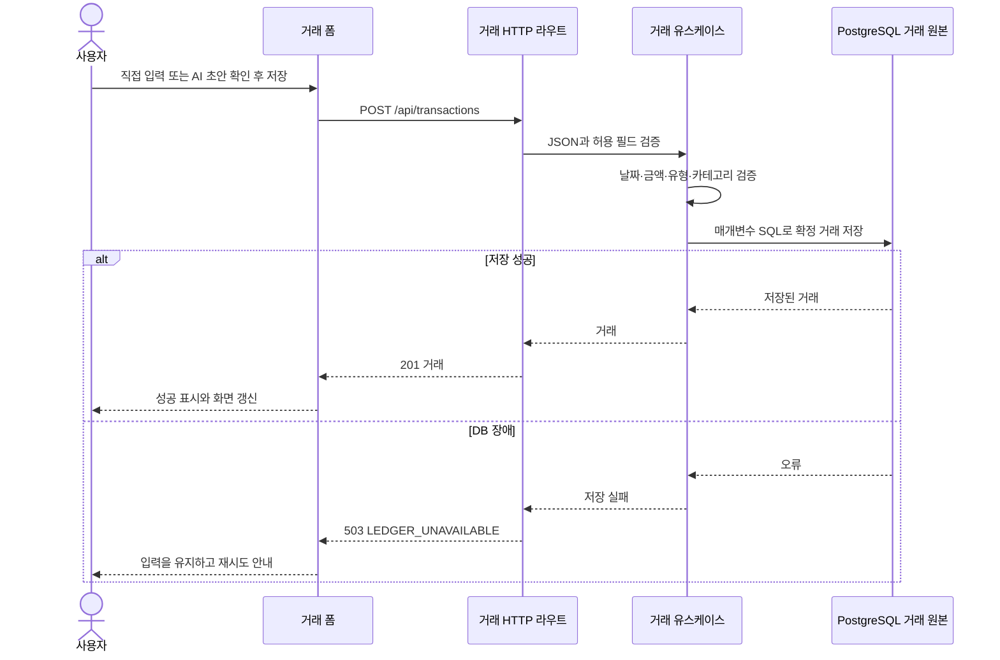

# 서버 거래 저장

## 범위와 설계 차이

대화형 통계의 선행 조건으로 거래 원본을 브라우저 localStorage에서 PostgreSQL의 거래 테이블로 옮긴다. RAG 검색 저장소에 날짜·금액을 추가하는 방식이 아니다. 거래 저장·조회·수정·삭제, 기존 브라우저 거래 가져오기와 UI 연결까지 포함한다. 거래 API와 오류의 기준은 [API 계약](api-contract.md#구현된-거래-저장-계약)이다.

현재는 **로그인 없는 로컬 단일 개인 가계부**다. 같은 서버에 접속한 모든 브라우저는 같은 거래를 읽고 바꾼다. 브라우저의 dataset_id는 RAG 검색 자료만 구분하며 거래 소유권이나 로그인 경계를 만들지 않는다. 인증 사용자·요청별 거래 스냅샷은 후속 설계다. 외부 공개·다중 사용자 서비스로 확장하는 작업은 포함하지 않는다.

`/api/summary`, 빈도·기간 비교 집계, 공통 도구·agent·채팅 모델은 이번 범위에 없다. 현재 화면의 합계는 서버에서 읽은 거래로 UI가 계산한다. 다음 통계 feature는 이 거래 원본을 SQL로 집계하도록 별도 구현한다. 기존 AI 추출 → RAG 분류 → 확인 후 저장 흐름은 유지한다.

## 저장소와 실행

기존 PostgreSQL과 승인된 psycopg를 사용한다. 새 의존성·환경 변수는 없다. `DATABASE_URL`을 그대로 사용하며 `.env.example`에서 설정 예시를 확인한다. 실제 .env는 읽거나 커밋하지 않는다.

```bash
docker compose up --build
```

UI는 http://localhost:8080, 개발 Compose UI는 http://localhost:5173 이다. DB·API는 Compose 내부에서 연결하며 호스트에 DB 포트를 공개하지 않는다. API 시작 과정의 마이그레이션 명령은 기존과 같다.

```bash
python -m account_book_server.migrate
```

버전 관리 SQL은 기존 RAG 자료를 유지하면서 거래 원본과 가져오기 이력 테이블을 추가한다. 반복 실행해도 자료를 지우지 않는다. 거래 테이블은 확정 거래의 날짜·유형·금액·통화·카테고리·사용처·메모를 저장한다. AI 초안은 확인 전에는 저장하지 않는다. 가져오기 이력은 거래 삭제 뒤에도 재시도로 되살아나는 것을 막기 위해 유지한다.

기존 `rag-data` 영속 볼륨 이름을 유지한다. 이제 이 볼륨에는 **거래 원본과 검색 자료가 함께** 있다. 일반적인 `docker compose down`은 보존하지만 볼륨을 삭제하면 둘 다 사라진다. 개발·기본 Compose에서 같은 거래를 사용하려면 같은 프로젝트 이름과 DB를 사용한다. 브라우저 포트가 달라도 같은 API·DB를 바라보면 서버 거래는 공유한다.

## 기존 브라우저 거래 이전

1. 원래 기록을 저장했던 브라우저·출처에서 새 UI를 연다. 5173과 8080의 기존 localStorage는 서로 다르다.
2. 화면의 기존 거래 가져오기 버튼을 누른다. 자동으로 이전하지 않는다.
3. UI는 기존 거래 ID를 유지해 최대 100건씩 전송한다. 서버는 배치 단위로 검증·저장한다.
4. 성공한 자료는 서버 거래로 조회한다. 브라우저 원본은 삭제하지 않고 백업으로 남긴다.
5. 중간 실패 시 다시 가져올 수 있다. 이미 가져온 동일 원본은 건너뛰며 서버에서 수정·삭제한 거래를 덮어쓰거나 복원하지 않는다. 충돌한 ID의 다른 원본은 409로 알린다.

DB 장애를 빈 거래 목록이나 성공 안내로 바꾸지 않는다. 서버 저장 실패 시 폼을 유지하며, localStorage에 대신 기록하지 않는다. 가져오지 않은 자료는 서버 거래 조회와 후속 통계의 대상이 아니다.

## 거래 저장 요청 흐름



RAG는 별도의 `rag_documents`를 사용한다. 서버 거래 변경은 즉시 거래 원본에 반영되지만 검색 자료는 기존대로 **다음 AI 요청**의 최소 분류 이력으로 갱신한다. 날짜·금액은 RAG 검색 자료에 저장하지 않으며 임베딩 재사용 규칙도 유지한다.

## 검증 범위

도메인·유스케이스 대역 테스트, HTTP 계약 테스트와 실제 PostgreSQL 통합 테스트로 검증한다. 날짜 양끝 포함, 유형·카테고리·사용처 필터, 정렬·페이지 이동, 입력 오류, 가져오기 중복·충돌·배치 원자성, 가져온 거래 수정·삭제 뒤 재시도를 포함한다. DB 재시작 후 거래·가져오기 이력이 유지되는지도 확인한다. AI 키 없이 거래 저장을 검증할 수 있다.

```bash
pytest
python scripts/validate_docs.py
npm --prefix ui test
npm --prefix ui run build
npm --prefix ui run lint
```

실제 DB 테스트는 다른 실행 자료와 분리된 테스트 DB의 `TEST_DATABASE_URL`을 사용한다. 실제 OpenAI 호출과 통계 API의 동작 검증은 이 feature의 완료 조건이 아니다.

### 2026-10-24 검증 결과와 제한

- Python 회귀 테스트 132개와 UI 테스트 69개가 통과했다. UI 타입 검사·빌드·문서 검증이 통과했고 린트는 기존 badge 컴포넌트 경고 한 개만 남았다.
- 분리된 PostgreSQL 18에서 `002_transactions.sql`을 직접 적용해 실제 저장소의 CRUD, 날짜·유형·카테고리·사용처 필터, 페이지 이동, 가져오기 충돌 롤백·재시도·동시 요청을 검증했다. DB 실제 재시작 후 거래와 가져오기 이력의 보존도 확인했다.
- 실제 HTTP → 유스케이스 → PostgreSQL 연결과 화면 저장·새로고침 후 조회를 확인했다. DB 중지 시 화면은 오류를 표시하며 0건·0원으로 바꾸지 않았다.
- Docker Desktop 시작 오류와 Windows의 임시 pgvector 라이브러리 로드 차단으로 Compose의 PostgreSQL 17 구성 및 전체 마이그레이션·pgvector 통합 테스트 16개는 완료하지 못했다. 위 거래 저장소 검증과 전체 마이그레이션 검증을 구분한다. 정상적인 pgvector 테스트 DB에서 `TEST_DATABASE_URL`을 설정한 전체 `pytest` 검증이 남아 있다.
